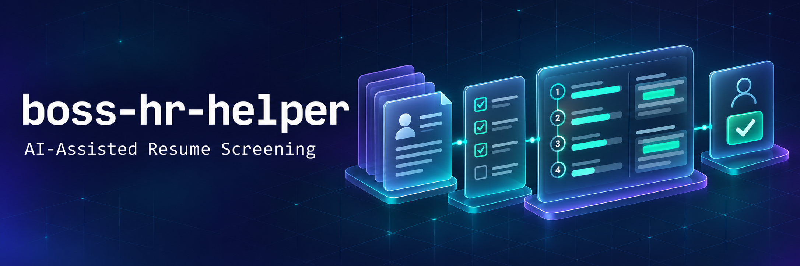

<p align="center">
  
</p>

# BOSS HR 智能筛选工作台

面向 HR 的多岗位简历筛选与人工审核原型，使用结构化岗位策略驱动候选人采集、分层评分、证据展示和审核流程。

当前已包含 **Vue 工作台、FastAPI 服务、SQLite 持久化、Mock/CDP Mock 浏览器接入，以及 Tier 0～3 通用评分流水线**。真实 BOSS 招聘端的 DOM/API 契约尚未完成核验，真实采集入口保持硬禁用；联系功能仅支持 Dry-Run 预演与人工状态登记。

本文按 2026-11-16 当前工作树整理。阶段报告记录的是当时版本，不能直接作为最新代码的运行或招聘效果证明。

## 技术栈

| 层次 | 技术 |
| --- | --- |
| 后端 | Python、FastAPI、Uvicorn、Pydantic、HTTPX |
| 前端 | Vue 3、TypeScript、Vite、Element Plus、Pinia、Vue Router、Axios |
| 数据库 | SQLite、Python sqlite3、SQL 增量迁移、Repository |
| AI 与算法 | Qwen / OpenAI 兼容模型服务、OpenAI SDK、BGE-large-zh-v1.5、Sentence Transformers、NumPy |
| 浏览器自动化 | Playwright、Microsoft Edge、Chrome DevTools Protocol（CDP） |
| 测试 | Python unittest、Playwright E2E、Node.js 原生测试 |
| 工程与配置 | Git、uv、npm、python-dotenv、JSON 配置 |

具体依赖以 [pyproject.toml](pyproject.toml)、[uv.lock](uv.lock)、[frontend/package.json](frontend/package.json) 和 [package-lock.json](frontend/package-lock.json) 为准。

## 功能与业务流程

```text
JD + HR 补充要求
  → 编译岗位策略草稿
  → 规范化 / 业务校验 / 质量检查
  → HR 确认具体内容 → 创建不可变版本 → 发布
  → 创建并锁定策略版本的扫描批次
  → 连接专用会话 → 页面岗位/筛选预检 → 人工确认
  → 列表预筛 → 详情采集与身份核验 → 简历快照 / 可评分输入
  → Tier 0 / 1 / 2 / 3 按条件执行
  → HR 核验证据、审核、联系预演或登记人工联系状态
```

系统对已导入或采集到的候选集合进行本地筛选评分，不承担全网候选人召回。

- **岗位策略**：原子要求、ALL/ANY 关系、来源引用、硬条件、关键词、正负锚点、动态维度、Rubric、权重和阈值。草稿编辑、确认、版本化和发布分开处理。
- **采集工作台**：按 HR 隔离浏览器会话；支持推荐页定位、预检、批次确认、扫描参数、进度、停止、错误提示和历史批次恢复。
- **候选人管理**：列表与详情分离、稳定身份去重、完整度与诊断展示、服务端分页/关键字/状态筛选、简历抽屉。
- **输入版本**：支持显式重新提取详情、追加完整评分输入版本；保留旧快照、评估和审核历史。普通重复扫描不会静默替换已封存输入。
- **评分与审核**：后台任务、结果复用、失败尝试、维度证据、缺失项、人工审核及独立联系事件。
- **持久化**：批次平台岗位/筛选确认、扫描扩展统计、运行 token、输入版本和审计记录。当前迁移目录为 001～012。

前端页面：`/policy` 岗位与策略、`/scanner` 采集与评分、`/review` 审核与排名。

## 评分算法与分数口径

当前工作台主线是 [PolicyScoringPipeline](engine/policy_scoring_pipeline.py)，各岗位差异由 `JobScoringPolicy` 描述；不是旧版固定 AI 岗位的四维评分。

| 阶段 | 主要行为 | 输出与边界 |
| --- | --- | --- |
| Tier 0 | 客观条件、区间/单位判断、ALL/ANY 三态组合 | PASS / FAIL / UNKNOWN；明确硬失败不被高分覆盖，未知交人工核验 |
| Tier 1 | 别名归一、每词最强来源、局部否定/学习/提及、覆盖与来源质量 | 0～100 规则初筛分，按岗位粗排阈值决定是否继续 |
| Tier 2 | 可追溯分块、BGE 余弦、同要求同块负向、有界扣分、同经历去重及 Top-K | 语义软分、计算覆盖、选中/排除证据；相似度不是能力概率 |
| Tier 3 | 按岗位动态 Rubric 逐维度评审，校验原文引用、缺失项和置信度 | 程序按 Policy 权重重算终审总分与路由建议 |

Tier 1 的基本口径为 `维度分 = 100 × 非线性关键词覆盖 × 来源质量`，再按岗位维度权重聚合；Tier 2 在原子要求与动态维度内聚合。详见 [规则粗排](engine/policy_rule_matcher.py)、[语义评分](engine/policy_semantic_ranker.py) 和 [终审服务](engine/policy_llm_reviewer.py)。

**成功 Deep 的最终总分仅来自 Tier 3 维度加权，不是 Tier 1 + Tier 2 + Tier 3。**

- `fast_mode` 只执行 Tier 0/1；其 `total_score` 是规则初筛分，不能与成功 Deep 的终审分直接当作同一种分数比较。
- `deep_mode` 按前置条件短路：硬 FAIL、输入不完整或规则分低于粗排门槛时，不运行完整后续模型。
- 硬条件 UNKNOWN 时，Deep 可补 Tier 2 软信号，但不进入 Tier 3。
- 当前 Tier 2 准入检查状态、计算覆盖率及每维状态，没有语义总分准入阈值。`semantic_coverage=1` 不代表候选人全部能力已被证实。
- 技术失败记录为失败尝试，不伪造候选人 0 分；推荐、不推荐和复核均为辅助建议，不授权发送。
- 引用存在不等于语义上支持评分，模型 `confidence` 也不是经过校准的正确率。

## 两条独立的运行配置轴

### 模型模式：APP_RUN_MODE

| 模式 | 策略编译 | Tier 0/1 | Tier 2/3 |
| --- | --- | --- | --- |
| `deterministic`（默认） | 本地 Demo 编译器 | 真实规则代码 | 确定性替身，不加载 BGE、不调用 Qwen |
| `live` | 已配置的真实模型服务 | 真实规则代码 | 本地 BGE 与真实模型终审 |

默认 Demo 编译器使用固定三个示例维度、空硬过滤和演示阈值；Tier 2 固定演示分为 80。它用于验证协议、路由和界面，不证明真实 JD 理解或招聘判断质量。展示规则差异应使用人工核验的合成 Policy 和对照数据。

### 数据来源：BROWSER_SOURCE

| 来源 | 实际行为 |
| --- | --- |
| `disabled` | 关闭采集路由；live 模型模式默认选择此来源 |
| `mock` | 内存合成列表/详情，不启动浏览器；deterministic 默认来源 |
| `cdp_mock` | 真实 Edge/CDP 操作本地合成页面，不访问真实 BOSS |
| `boss_readonly` | 保留适配接口；未授权时降级关闭，即使设置允许开关，应用工厂仍拒绝真实采集 |

`live + mock` 表示真模型处理合成数据；`deterministic + cdp_mock` 表示真浏览器驱动合成页面、评分模型为替身。两者都不等于真实 BOSS 兼容性验收。

## 本地启动与无账号演示

以下命令使用 Windows PowerShell，在项目根目录执行。需要 Python 3.10+（项目 `.python-version` 为 3.11）、Node.js/npm；使用 CDP Mock 时还需要本机 Edge 与 Playwright。

### 1. 安装依赖

已有可用环境可跳过安装。按锁文件安装后端与开发依赖：

```powershell
uv sync --frozen --extra dev
```

前端依赖：

```powershell
Set-Location .\frontend
npm ci
Set-Location ..
```

若 PowerShell 阻止执行 `npm.ps1`，可在命令提示符中执行 `npm ci`，无需为演示修改全局脚本策略。

Mock 主线不需要 BOSS 账号、Cookie、BGE 模型或 LLM 密钥；可选 CDP 使用本机 Edge channel。

### 2. 准备独立演示库与身份

首次演示请先执行 [无真实账号演示全流程](reports/demo_before_boss_20261116/无真实账号演示全流程.md) **第 3 节的完整准备块**。它通过现有 Repository/Service 创建：

- 独立 `data/demo_before_boss_时间/demo.sqlite3`，不覆盖默认业务库。
- `demo-org`、管理员 `demo-owner`、HR `demo-hr`。
- 流程岗位 `job-flow`、人工合成算法岗位 `job-algorithm`，均完成策略确认发布。
- 10 份合成简历、API/前端可用 JSON、策略与实际 ID manifest。

`db-init` 只创建数据库结构，不自动创建组织、用户或岗位。现有真实部署须由可信的 `ProvisioningContext` 初始化身份；不能仅填写任意组织/用户 ID 代替认证。

准备块会设置 `RECRUITMENT_DB_PATH`。继续使用同一终端启动后端；换终端时应重新指向该演示库。

### 3. 启动后端

```powershell
if (-not $env:RECRUITMENT_DB_PATH) { throw '请先准备独立演示库并设置 RECRUITMENT_DB_PATH' }
$env:APP_RUN_MODE = 'deterministic'
$env:APP_ALLOW_TRUSTED_HEADERS = '1'
$env:BROWSER_SOURCE = 'mock'
$env:BROWSER_ALLOW_REAL_BOSS = '0'
.\.venv\Scripts\python.exe -B -X utf8 -m uvicorn server.app:app --host 127.0.0.1 --port 8000
```

### 4. 启动前端

另开终端，从项目根目录执行：

```powershell
Set-Location .\frontend
$env:VITE_API_TARGET = 'http://127.0.0.1:8000'
node .\node_modules\vite\bin\vite.js --host 127.0.0.1 --port 5173 --strictPort
```

项目的 `npm run dev` 也执行 Vite；上面直接用 Node 启动，便于避开 PowerShell 对 `npm.ps1` 的脚本策略限制。

| 入口 | 地址 |
| --- | --- |
| 工作台 | http://127.0.0.1:5173 |
| 后端健康 | http://127.0.0.1:8000/api/health |
| 运行模式与来源 | http://127.0.0.1:8000/api/runtime-mode |
| OpenAPI | http://127.0.0.1:8000/docs |

前端默认代理后端 8000；可用 `VITE_API_TARGET` 调整。后端 CORS 默认放行本地 5173。

### 5. 操作顺序

1. 顶部选择本地演示管理员和流程岗位，确认策略已发布。
2. 在评分台创建/选择批次，连接或召唤专用会话。连接当前岗位可自动定位 Mock 推荐页，也可点击“打开/定位推荐页”。
3. 读取页面岗位与筛选预检，核对后勾选确认；确认信息持久化到批次。会话重启后仍需要重新连接，持久确认不等于浏览器一直在线。
4. 选择“仅扫描入库”或“自动执行 Fast 初筛”，设置上限后开始只读扫描。
5. 选候选人执行 Fast/Deep，查看简历详情、完整度、维度证据、缺失项与历史。
6. 对不完整或已变化的浏览器简历，可显式“重新提取详情并更新快照”；完整新内容追加输入版本，不覆盖历史。
7. 到审核看板核验证据、批准或要求复核，再做 Greeting Dry-Run。手工“已联系”只是事实登记，不执行平台发送。

算法对照岗位请选择准备阶段的历史批次，避免选中新建空批次后看不到已有测试数据。手工合成简历用于评分对照；联系预演须使用 Mock/CDP 扫描得到、可重新定位的人。

## 可选：可见 Edge 与真实模型

### CDP Mock

保留独立演示库，在自己的后端终端停止服务后设置：

```powershell
$env:BROWSER_SOURCE = 'cdp_mock'
$env:BROWSER_CDP_PORT = '9336'
$env:BROWSER_CDP_AUTOLAUNCH = '1'
$env:BROWSER_HEADLESS = '0'
$env:BROWSER_USER_DATA_DIR = Join-Path (Split-Path $env:RECRUITMENT_DB_PATH -Parent) 'edge-base'
.\.venv\Scripts\python.exe -B -X utf8 -m uvicorn server.app:app --host 127.0.0.1 --port 8000
```

使用独立 HR profile；最终路径由会话注册器按用户/端口划分，并非直接使用 `edge-base`。可通过 [浏览器绑定命令](scripts/bind_browser_account.py) 显式分配账号标识、端口和 profile ID；不存密码或 Cookie。详细命令见 [演示手册](reports/demo_before_boss_20261116/无真实账号演示全流程.md) 第 10 节。

当前工作树包含连接后直达 Mock 推荐页、复用空白标签页和陈旧 Page/连接的一次恢复逻辑；这不代表真实平台登录、风控或页面协议已验证。

### live 模型

准备实际存在且符合编码契约的本地 BGE，以及支持所需结构化输出的模型服务。环境变量模板见 [.env.example](.env.example)。本地可复制为 `.env`，已有文件不应覆盖；密钥不提交仓库。

| 变量 | 用途 |
| --- | --- |
| `EMBEDDING_MODEL_PATH` | 本地 BGE 模型目录 |
| `LLM_BASE_URL` | OpenAI 兼容服务地址 |
| `LLM_API_KEY` | 模型凭证 |
| `LLM_MODEL_NAME` | 实际使用的模型名称 |

在**新独立库/新评分上下文**上设置 `APP_RUN_MODE=live`，按需要显式保留 `BROWSER_SOURCE=mock`。若是本地合成演示，还需 `APP_ALLOW_TRUSTED_HEADERS=1`；live 默认不隐式信任身份头，正式部署应接入认证网关。

当前结果复用不按 `APP_RUN_MODE` 单独隔离，直接在已 Mock 深评的同一上下文切 live，可能返回旧结果而没有发起真请求。应核对实际模型、资产、请求与可用用量；模型失败和供应商未返回字段均保留原状态，不用 Mock 分数替代。

## 配置与数据持久化

| 配置 | 当前用途 / 默认值 |
| --- | --- |
| `APP_RUN_MODE` | `deterministic` / `live` |
| `APP_ALLOW_TRUSTED_HEADERS` | 本地身份便利入口；deterministic 默认允许，live 需显式开启 |
| `BROWSER_SOURCE` | `disabled` / `mock` / `cdp_mock` / `boss_readonly` |
| `RECRUITMENT_DB_PATH` | 默认 `data/recruitment.sqlite3`；相对路径按项目根目录解析 |
| `RECRUITMENT_DB_BUSY_TIMEOUT_MS` | SQLite 等待超时，默认 5000ms |
| `BROWSER_CDP_HOST` / `BROWSER_CDP_PORT` | 默认 `127.0.0.1` / `9222` |
| `BROWSER_CDP_AUTOLAUNCH` / `BROWSER_HEADLESS` | 自动启动 / 无头，默认均开启 |
| `BROWSER_USER_DATA_DIR` / `BROWSER_CHANNEL` | 专用 profile 基础位置 / 默认 `msedge` |
| `BROWSER_ALLOW_REAL_BOSS` | 不能替代真实契约验证，也不能绕过应用真实源硬门禁 |

岗位维度、权重、阈值来自已发布 Policy；规则执行参数见 [prescreen_profile.json](config/prescreen_profile.json)，编码、分块和语义参数见 [semantic_profile.json](config/semantic_profile.json)。`config.json` 属旧 V2 兼容路径，不是当前工作台的统一岗位配置。

数据库迁移采用追加 SQL，目前文件为 001～012。指定目标库管理：

```powershell
$dbPath = Read-Host '输入需要管理的数据库路径'
# 新建空库结构；不创建身份和岗位
.\.venv\Scripts\python.exe -B -X utf8 main.py db-init --database $dbPath
# 检查 schema、待迁移项、外键与完整性；不存在的库不会被创建
.\.venv\Scripts\python.exe -B -X utf8 main.py db-check --database $dbPath
```

已有库应先备份，再按需执行 `main.py db-migrate --database $dbPath`。不要修改已经应用的迁移或绕过不可变约束。

012 增加了批次预检确认、扫描扩展计数与 `run_token`、候选人输入版本。显式重采时，PARTIAL 仅保留诊断快照；COMPLETE 且合法的新内容可成为新的当前输入。相同内容复用当前版本，旧评估仍指向原快照。普通重复采集保留现有封存输入，不自动升级；输入版本回退也不是现成的 UI 功能。

## API 与命令行入口

完整接口、请求体和响应以运行中的 `/docs` 为准。业务接口使用本地演示身份头或可信网关提供的身份；Repository 再校验组织成员与岗位权限。

| 功能 | 主要 HTTP 入口 |
| --- | --- |
| 岗位与策略 | `/api/jobs`、`/api/jobs/{job_id}/policies/...` |
| 浏览器会话 | `/api/browser/session`、`/api/browser/session/connect`、`/api/browser/session/navigate` |
| 预检与确认 | `/api/jobs/{job_id}/browser/precheck`、`/api/jobs/{job_id}/batches/{batch_id}/browser/precheck/confirm` |
| 批次与候选人 | `/api/jobs/{job_id}/batches`、`/api/jobs/{job_id}/candidates` |
| 简历与重采 | 候选人前缀 `/api/jobs/{job_id}/candidates/{id}` 下的 `/resume`、`/re-extract` |
| 扫描/状态/取消 | 批次前缀 `/api/jobs/{job_id}/batches/{batch_id}` 下的 `/browser/scan`、`/browser/scan/cancel` |
| 评分与任务 | `/api/jobs/{job_id}/candidates/{id}/score`、`/api/jobs/{job_id}/tasks/{task_id}` |
| 审核与联系预演 | 评估前缀 `/api/jobs/{job_id}/evaluations/{id}` 下的 `/reviews`、`/contact`、`/greeting-dry-run` |

评分创建接口可能直接返回复用评估，或返回后台任务；需轮询任务状态，不能只凭 HTTP 200 认定评分已完成。

统一 CLI 为 [main.py](main.py)：

| 命令组 | 用途 |
| --- | --- |
| `db-init` / `db-check` / `db-migrate` | 数据库管理 |
| `policy-schema` / `policy-validate` / `policy-compile` | 通用策略协议、检查与真实编译 |
| `policy-draft` / `policy-update` / `policy-confirm` / `policy-version` / `policy-publish` | 草稿编辑、确认和发布 |
| `policy-current` / `policy-history` / `policy-runs` | 策略与编译记录查询 |
| `prescreen` / `prescreen-benchmark` | 通用 Tier 0/1 与规则固定集 |
| `embedding-check` / `semantic-prepare` / `semantic-diagnose` | 本地模型契约、向量资产与 Tier 2 诊断 |
| `tier3-review` | 动态 Policy 终审，默认 Mock；`--live` 调用真实模型 |
| `policy-diagnose` | 显式真实策略编译诊断，要求 `--live` |
| `test` | unittest 测试入口 |

参数按需查看，例如 `python main.py prescreen --help`、`python main.py tier3-review --help`。部分命令会写指定库或输出文件，真实模型命令会产生外部请求。

### 旧 V2 兼容入口

[HybridScoringEngine](engine/hybrid_engine.py)、[job_compiler.py](config/job_compiler.py)、`config.json` 和 JSON 评分缓存仍保留。`benchmark`、`diagnose`、`sample`、`llm-diagnose` 主要服务旧路径的基准或诊断，不等同工作台通用 Policy 的完整验收。

旧固定四维、45/55 粗排、旧 Prompt/超时与 `AUTO_GREET` 队列资格不要套到当前动态维度流水线。当前通用终审默认超时为 90 秒；旧 Tier 3 单例诊断的 45 秒/思考参数有独立运行配置。`AUTO_GREET` 也不是已发送消息的证据。

## 测试与验收

后端主入口：

```powershell
.\.venv\Scripts\python.exe -B -X utf8 main.py test --quiet
```

套件覆盖规则、Schema、Repository、迁移、API 和本地浏览器场景，包含可选本地真实 BGE/Edge 用例；依赖不足时部分用例可能跳过。它不是“全部均为纯 Mock”，也不代表真实 BOSS 或招聘效果验证。

前端命令在 `frontend/` 下执行：

```powershell
node --test tests/requestGate.test.ts
npm run build
```

本地 UI E2E（需要 Edge/Playwright 和已安装前端依赖）：

```powershell
.\.venv\Scripts\python.exe -B -X utf8 -m tests.frontend_e2e
```

E2E 会创建隔离临时库、启动测试服务和本地浏览器。Mock、CDP Mock、真实模型、真实平台和业务效果应分别记录；阶段报告中的通过数不是当前工作树重新通过的结论。本次 README 更新没有代为运行全量测试、UI E2E 或真实模型调用。

## 当前限制

- **真实平台与发送**：真实 BOSS 的授权、DOM/API、分页、登录/风控未完成验证；`boss_readonly` 仍硬禁用。Dry-Run 只创建/复用 `PENDING + DRY_RUN`，不会记成已发送；手工 `CONTACTED` 也不是平台送达回执。
- **算法与效果**：列表预筛的要求图投影和年限区间解析仍有误筛风险；关键词/向量/引用存在不能证明经历真实或结论正确。真实标注集、阈值标定、召回/排序/人工成本对照仍需补充。
- **排名与批量交互**：当前排行查询在同人多评估时仍有重复行风险；批量 Deep 只挑未评分者，已有 Fast 升级应使用单人 Deep。候选人列表已实现服务端分页，不能再按早期“仅客户端分页”介绍。
- **恢复与扩展**：扫描统计和运行 token 已持久化，旧扫描回调受 token 约束；浏览器会话与取消信号仍含进程内状态。取消/重试不等于持久游标暂停恢复，线程池也不是分布式任务队列。
- **认证与隐私**：本地受信身份头不能替代生产认证。已剥离或在库层拒绝部分凭证字段，但真实 PII 加密、保留期限和删除任务尚未完成，自由文本也不保证已完全去标识。

## 项目结构与文档

```text
boss-qhr-helper-dev/
├── main.py                  # 统一 CLI
├── pyproject.toml / uv.lock  # Python 依赖
├── .env.example             # 运行配置模板
├── config.json              # 旧 V2 配置
├── config/                  # 通用策略编译/规范化/校验、执行 Profile、Prompt
├── schemas/                 # 简历、策略、评分与流水线契约
├── engine/                  # Tier 0～3、分块/向量、任务编排及旧兼容引擎
├── storage/                 # 业务数据库、001～012迁移、Repository与旧缓存
├── browser/                 # Mock/CDP适配、身份、采集、会话与预演
├── server/                  # FastAPI、认证上下文、运行模式与会话服务
├── frontend/                # Vue工作台、类型、API客户端与请求状态隔离
├── scripts/                 # 专用Edge启动、浏览器账号映射
├── tests/                   # 单元/存储/API/迁移/模型契约/本地E2E
├── reports/                 # 阶段交付、诊断、演示与验收证据
├── data/                    # 本地数据库和隔离演示数据
├── doc/                     # 产品/开发材料与参考资料
└── 开发文档/                # 早期PRD、计划、格式与结构规划
```

| 资料 | 内容 |
| --- | --- |
| [完整无账号演示手册](reports/demo_before_boss_20261116/无真实账号演示全流程.md) | 初始化命令、工作台操作、API核验、CDP/live可选路径 |
| [合成测试数据与预期](reports/demo_before_boss_20261116/测试数据与预期.md) | 10组对照数据、可复制JSON、规则分与失败状态 |
| [演示方案验收记录](reports/demo_before_boss_20261116/演示方案验收记录.md) | 实际执行范围及未验证部分 |
| [演示材料索引](项目演示材料索引.md) | PPT逐页稿、算法导学、开发复盘与问答 |
| [Sprint 5 Batch 2 报告](reports/sprint5/sprint5_batch2_delivery_report.md) | 012、输入版本化、预检/扫描持久化与服务端分页 |
| [Sprint 5 Batch 2.1 报告](reports/sprint5/sprint5_batch2_1_delivery_report.md) | 当前工作树的CDP生命周期恢复与连接后定位 |
| [历史架构报告](reports/architecture_integration_audit.md) | 阶段架构检查与实现边界 |

早期结构说明、演示材料和交付报告均保留原阶段上下文，其中“012未实现”“缺少输入升级”“仅客户端分页”等结论已被后续实现更新。查看当前能力应结合本文和实际源码；查看历史验收则保留原版本、模式与样本范围。
