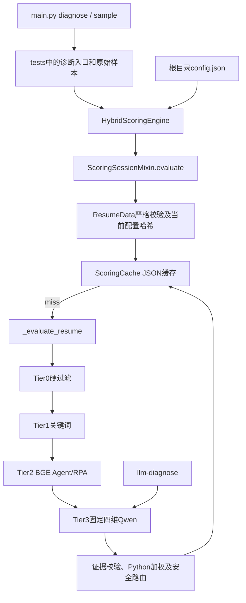
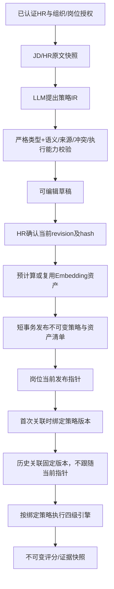

# Phase 1.7 Stage 1：代码审计与架构设计

## 1. 范围和证据口径

输入为用户附件《Phase 1.7：通用多岗位招聘匹配引擎改造计划》及三项关键要求。附件Stage 1只要求检查模块、定位固定规则、梳理结构/数据库/调用关系并提出迁移方案；本次只写报告，不修改引擎、Schema、配置或测试实现，不执行SQLite业务迁移，不调用真实模型。

本报告用“当前事实”描述源码；用“设计提案”描述未来架构；没有实现或验证的能力明确列为待完成。文件定位以本次源码快照为准，见 `source_manifest.json`。仓库当前实现文件尚未提交到Git，不能依赖一个已提交的HEAD声称已生成可审阅PR；本次交付为本地报告。

**需要纠正的前提：** 附件提出“根据现有SQLite数据库增量设计”，但本仓库未发现SQLite业务库、表定义、`sqlite3`/ORM访问代码或 `.db/.sqlite/.sqlite3` 文件（排除虚拟环境、工具缓存）。`storage/` 目前是JSON文件缓存。因此应保留现有缓存，新增SQLite业务持久层；不能把缓存文件当成既有业务表，也不推断工作区之外没有其他数据库。

## 2. 当前调用链

| 位置 | 当前事实 |
| --- | --- |
| `main.py:5` | 统一CLI转发test/benchmark/diagnose/sample/llm-diagnose，没有组织、岗位创建、发布或持久化管理入口 |
| `config/settings.py:8`、`:9` | 项目根定位和单一默认config.json，模型凭证只从环境读取 |
| `engine/hybrid_engine.py:25`、`:35`、`:60` | 构造时加载一份配置并初始化模型；不接受job_id或候选人绑定版本 |
| `engine/scoring_session.py:53`、`:76` | 校验简历，以当前self._config、简历内容和模型/Prompt版本生成缓存键 |
| `engine/hybrid_engine.py:110` | 四级调度；低粗排不调用LLM，fast/异常不进入AUTO |
| `engine/llm_reviewer.py:47`、`:81`、`:84`、`:108` | 请求构建、调用、原文证据校验、Python加权 |
| `engine/llm_observability.py:44` | HTTP调用和校验分阶段观测，截断输出失败；没有业务数据库持久化 |
| `engine/llm_diagnostics.py:27` | 单Tier3诊断，明确跳过Tier1/2且只人工核验；不能当作完整评分成功 |
| `storage/scoring_cache.py:53`、`:83`、`:111` | 缓存JSON读取、put、原子替换；同一键仍可被put覆盖，不是不可变评分账本 |

`get_source_texts`等文本投影在 `engine/resume_text.py`；`schemas/common.py`、`schemas/candidate.py`、`schemas/card.py`负责输入契约与映射问题；`schemas/evaluation.py`负责输出范围和安全状态。它们的核心职责应保留。

## 3. 固定岗位规则审计

| 编号 | 当前事实及代码位置 | 多岗位风险 | 最小迁移方向 |
| --- | --- | --- | --- |
| A01 | `config/job_compiler.py:34` 固定agent/rpa；`:82` Prompt明确偏AI；`:126` 固定应届/年限；`:138` 固定40/30/20/10；`:161` 注入AI词表默认项 | 任意JD仍可能产出AI岗位策略；JD未写年限也会被加入限制 | 编译IR和能力关系由输入生成，客观硬条件必须可溯源；旧AI规则迁为首个策略样本 |
| A02 | `config/job_compiler.py:96` 已用Pydantic结构化parse，**并非只有提示词字符串**；但`:173` 直接写配置，未调用最终validate_config，无草稿/确认/发布事务 | 结构正确不等于语义正确，更不等于已获HR授权生效 | 保留结构输出能力，增加语义分析、执行能力检查、确认哈希和发布门控 |
| A03 | `CompiledScoringProfile:39` 无requirement来源、推断标记、冲突、动态维度；默认extra/类型行为非通用strict契约 | “了解Redis更好”被提升为必须项时无法追责；无法阻止不支持的谓词 | 严格Policy Schema + 引用位置 + 类型化谓词 + 编译诊断 |
| A04 | `config/validation.py:32` 维度集合固定；`:42` 要求组键恰好agent/rpa；`:5` 配置层反向依赖semantic_ranker | Java/销售策略会被拒绝；配置和执行器耦合 | 通用Policy验证独立于模型初始化；解释器声明所支持的Policy能力 |
| A05 | `engine/hard_filter.py:95` 起只读取学历/薪资/求职/活跃/年限等固定字段；没有地点等通用谓词接口 | 新条件只能继续加if分支；能力缺失容易被误作硬否决 | 有限字段/运算符白名单，PASS/FAIL/UNKNOWN，不执行LLM生成代码 |
| A06 | `engine/rule_matcher.py:7` AI别名、类别词表；`:83`、`:114` 缺项时回落AI默认；`:143` 总45封顶 | 名义上读配置，漏项仍污染Java/销售结果 | 通用执行器不携带岗位词表；来源权重、类别预算和去重算法保留 |
| A07 | `engine/rule_matcher.py:28` 实现动作词偏开发；`:37` 用其判断证据强弱；Tier3 `llm_reviewer.py:98` 只对三个固定维度要求实战 | 销售“独立谈判促成成交”可能因无“编写/部署”等词被降权 | 岗位定义可接受的证据类别与动作信号，公共算法不写死开发词 |
| A08 | `engine/semantic_ranker.py:41` 固定agent/rpa；`:48` 附近每次构造encode锚点；`:75` 每次语义评分encode候选块；`:140` 附近取最高路线 | 不支持任意ALL/ANY树；无持久向量复用 | 保留块内惩罚、Top-K、同经历去重；改为策略组解释器和资产仓库 |
| A09 | `engine/llm_reviewer.py:10` DIMENSIONS、`:16` RUBRIC、`:62` 顶层键、`:98` 证据门槛、`:110` 加权映射固定；`schemas/evaluation.py:28` 固定四字段 | 改配置无法改维度，销售岗位仍被AI四维审查 | 固定安全协议 + 已发布动态维度/Rubric；维度ID集合严格相等 |
| A10 | `engine/scoring_session.py:34` 按当前配置产生版本；`:79` 无org_id/job_id/关联记录；`:95` 缓存深评按当前配置重算路由 | reload后同一候选人换口径；不同组织缺少隔离；不能满足C方案 | 历史事实先查DB，候选关联绑定版本后再加载快照；缓存降为加速层 |
| A11 | `schemas/candidate.py:50` candidate_key来自采集元数据，现样本含job前缀；`schemas/evaluation.py:69` 无job/policy外键 | 不能把现candidate_key直接当跨岗位自然人ID；仅存字典无法约束串用 | 组织内candidate实体+外部身份别名+岗位关联，保留原key，不按姓名合并 |
| A12 | `storage/scoring_cache.py:83` JSON可覆盖；未发现organizations/users/jobs等实体或访问代码 | 文件缓存不能提供数据库级不可变、授权、保留与恢复保障 | 新增SQLite业务库，先实现约束再接执行流程 |
| A13 | `tests/test_session.py:61` 明确验证reload后按新配置重算；`tests/test_job_compiler.py:11` 只验证AI编译配置可加载 | 现测试通过不能证明多岗位/历史不可变；部分旧断言将需通过legacy路径保留 | 不删除90项安全测试；补C方案数据库直接SQL反例及三岗位矩阵 |

以上是针对新目标的架构缺口，不将“目前只支持一个岗位”夸大为已部署多租户的数据泄漏事件；当前没有这样的运行证据。

## 4. 新旧架构对照（设计提案）

| 当前 | 建议目标 | 保留部分 |
| --- | --- | --- |
| 一份全局config | org → job → draft → immutable policy version | config.json只作为兼容导入源与运行环境配置来源 |
| Compiler直接产文件 | 编译IR → 静态检查 → HR确认 → 发布快照 | Pydantic、结构输出与原JD文本 |
| 内存锚点 | 原文/版本 → 可重建派生Embedding资产及发布映射 | 当前BGE和余弦、Top-K算法 |
| evaluate(resume) | evaluate(org_context, job_id, candidate_identity)先取已绑定版本 | 四级结构、缺失三态和异常路由 |
| 当前配置+哈希缓存 | 不可变评分事实 + 可清理加速缓存 | 缓存哈希/原子写的工程能力 |
| 固定四维 | 有限、可执行的动态维度集合 | 严格Schema、原文引用、置信度、Python加权 |

## 5. Compiler必须成为策略编译模块

这里的“编译”不指让LLM生成任意Python、SQL或新的system prompt。建议输出受限、带类型的中间表示和可执行计划：

1. **输入快照**：original_jd、hr_requirements、结构化输入分别保存，带source_id、内容哈希及Unicode字符偏移。组织、job_id、操作人由可信服务上下文提供，不由LLM生成。
2. **LLM提取IR**：要求节点、能力组、优先级、别名、锚点、维度和Rubric均有稳定ID；每项含source引用、EXPLICIT/INFERRED/PLATFORM_DEFAULT、needs_confirmation。
3. **类型检查**：Pydantic strict、extra=forbid、范围与规模上限；source_path、运算符、聚合器只能选解释器已支持的白名单。
4. **语义检查**：ID唯一、引用存在、组结构无环、ALL/ANY子节点非空、维度与要求引用合法、关键词别名冲突显式处理、来源引用是连续原文；数值/单位正常化。
5. **强制性检查**：REQUIRED/PREFERRED/OPTIONAL是优先级，ALL/ANY是组合逻辑，二者不能混用。REQUIRED能力缺乏关键词/相似度不等于确定失败；只有显式并经确认的客观谓词可进入Tier0硬拒绝。
6. **冲突检查**：如JD本科、HR硕士，或“Redis更好”被标REQUIRED，生成可解释诊断；不能用“HR优先”静默改写。冲突未解决不能发布。
7. **确定性降级与归一化**：Python计算权重归一化、预算和引用索引，保留原始权重及变换记录；没有明确数值的岗位门槛不编造。缺失阈值采用已标记平台默认并由HR确认，不改当前AI迁移值。
8. **执行能力检查**：把每条规则映射到Tier/解释器指令，运行静态dry-run。当前引擎不支持的谓词/聚合器/策略协议必须报UNSUPPORTED，而不是生成一个看似合法但无法执行的JSON。
9. **HR确认**：记录草稿revision、完整hash和确认人。任何修改使旧确认失效；LLM不能发布，HR确认也不能跳过编译校验。
10. **发布清单**：policy_schema_version、compiler_version、validator_version、engine_protocol_version、source/IR/policy hash、模型修订和所有诊断/解决记录可追溯。Embedding预备完成后才原子切换当前版本。

提议的 `JobScoringPolicy` 仅是本阶段设计结构，不是已实现Schema：

| 字段组 | 关键字段 |
| --- | --- |
| 身份与协议 | org_id、job_id、policy_id、policy_version、policy_schema_version、engine_protocol_version |
| 原文 | original_jd、hr_requirements、structured_inputs、source_documents |
| 客观条件 | hard_filters[{id,field,operator,value,unit,source_refs,confirmed}] |
| 能力关系 | requirements[{id,priority,source_refs,origin}]、requirement_groups[{id,operator:ALL/ANY,children}] |
| 关键词 | keyword_rules[{id,canonical,aliases,category,priority,score_weight,evidence_types}] |
| 锚点文本 | semantic_anchors[{anchor_id,group_id,polarity,text,text_hash,source_refs}] |
| 维度 | scoring_dimensions[{id,name,requirement_ids,weight,rubric,evidence_policy}] |
| 算法参数 | tier1_categories/budgets、tier2_top_k/aggregation/penalties、scoring_thresholds |
| 编译轨迹 | compiler_metadata、conflicts、confirmations、source_hash、canonical_policy_hash |

向量不在Policy JSON里。模型执行修订及派生资产清单独立存储，发布记录将它们和Policy关联；详见数据库报告。

动态LLM输出外层维持稳定 `{dimensions:[{dimension_id,score,confidence,evidence,missing_evidence}],highlights,risks,overall_assessment}`。Schema限制ID枚举及维度数量，Pydantic额外检查ID唯一、集合完全相等；权重与最终路由不交给模型。保留本次已验证的Qwen非思考、45秒、0重试、顶层对象要求和原文校验，模型别名不能作为不可变修订的证明。

## 6. C方案的关键解释

“配置变化使缓存miss”与“历史候选人不换评分口径”是不同需求。当前代码满足前者，不满足后者。

建议首次建立岗位关联时，数据库就固定policy_id，包括尚未评分或只取得卡片的候选人；正式评分取关联版本，不取jobs.current。重复采集只追加采集事件及新的简历快照，不更新绑定版本、已封存评分输入或正式结果。原文补全与新的独立简历更新应分开记录，具体约束见数据库报告。

## 7. 增量迁移与每阶段门槛

| 阶段 | 预期改动，尚未实施 | 进入下一阶段前验证 |
| --- | --- | --- |
| Stage2 | 通用Schema、SQLite核心表、版本/关联/结果约束；保留旧API | 直接SQL不能更新/替换历史；跨org/job/version外键失败；发布与采集并发顺序明确 |
| Stage3 | 真正的Policy Compiler、冲突与来源、HR确认哈希 | Redis“更好”不会成硬要求；缺来源/未确认/执行器不支持均不能发布 |
| Stage4 | 客观谓词解释器与动态关键词 | Java/销售无AI默认污染；未知数据三态；来源去重和类别预算不退化 |
| Stage5 | Embedding资产仓库、文本/模型/处理版本缓存、通用组树 | 仅改权重复用资产；改文本只重算对应锚点；跨岗位复用但组织不混用 |
| Stage6 | 动态维度与Rubric、固定安全协议 | 维度缺失/重复/额外项失败；证据/超时/截断保持失败安全 |
| Stage7 | job上下文、固定版本加载与不可变结果存储 | V2发布后旧候选人及未评分者仍使用V1；重复导入不重评分；新候选人用V2 |
| Stage8 | 三岗位矩阵、90项原回归、真实编译+动态评分 | Mock与真实严格分开；先确认架构与数据库约束再做真实验收 |

Stage2可先发布 `legacy_ai_v2` 协议的已确认迁移策略，通用协议在其解释器未实现前标为不支持，不能提前让当前引擎执行。迁移采用adapter双轨，按冻结配置比对旧五类样本的分数、证据及路由；不自动改45/55、40/30/20/10、52/60/82，也不将Compiler另行默认的55/60/85悄悄视为等价。

旧config.json完整保留，导入其真实值、来源及哈希，不能要求LLM重新推断后声称迁移一致。现有JSON缓存及诊断报告属于运行证据：没有组织/关联/确认记录的旧结果默认只作为LEGACY_UNASSIGNED档案，不自动变成已授权岗位正式评分；人工确认映射并验证来源后再导入。

## 8. 本阶段验证与待审查点

原有 **90项回归本次实际运行，90项通过，0失败、0错误、0跳过**，只验证当前V2契约，不证明未来多岗位和SQLite能力已经实现。记录见 `baseline_tests.log`；数据库报告另有38项临时SQL样机检查，与未来生产迁移验收分开。

建议人工审查的默认选择：组织内默认岗位私有、显式授权；SQLite BLOB保存向量；版本状态由草稿/发布事实/当前指针派生；保留期限不预填任意天数；重复采集不换版本也不自动重新评分；卡片到完整简历允许同次采集补全、评分输入封存后不替换。保留期限与不可变记录的边界、恢复后防止数据复活详见数据库报告。

**停止点：** 本次仅Stage1报告，不进入Stage2；没有实现新策略Schema、数据库表、通用Compiler或多岗位引擎。
