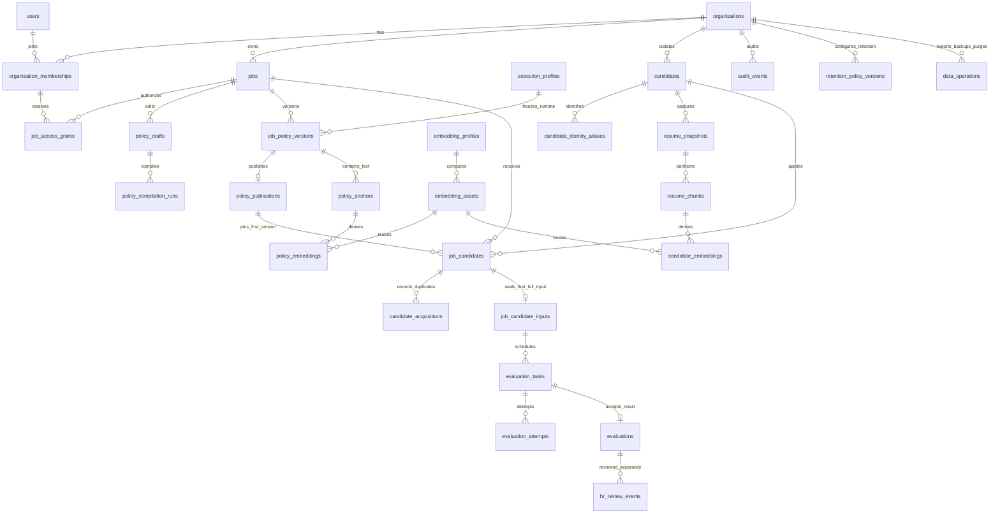

# Phase 1.7 Stage 1：SQLite数据库设计提案

## 1. 设计边界与决策摘要

**这是待审查的设计，不是已实施的数据库。** 当前仓库只有JSON评分缓存，没有发现可复用的SQLite业务表。本次不新增生产数据库、不写storage实现或迁移；下文SQL仅是C方案核心约束的设计样机。

核心决定：

1. 草稿可编辑，已发布策略内容不可变；DRAFT/PUBLISHED/ARCHIVED是生命周期，不能靠修改已发布内容行来表示。
2. 候选人与岗位首次关联时就绑定策略版本，包括未评分候选人；重复采集只追加事件，不改绑定、不改正式评分。
3. 原始JD、HR要求、锚点文本、编译轨迹、策略版本一直是事实来源；向量是独立派生资产。资产键不包含整份策略的权重哈希，因此改权重可以复用向量。
4. 评分事实是不可覆盖的数据库记录，JSON缓存不是事实来源。配置变更不得通过缓存miss触发旧候选人换口径重评。
5. 组织、成员、岗位授权、保存期限、完整导出及手动备份恢复从底层预留。SQLite没有服务端按HR身份自动隔离行的能力，需可信后端控制读取；数据库负责跨组织/岗位外键和不可变写约束。
6. 不引入向量数据库或新ORM。MVP建议标准库sqlite3 + SQLite内float32 BLOB，减少向量文件与数据库备份不一致的风险。

## 2. 实体关系



ER图只展示主要关系。**所有业务关联实际使用包含org_id、job_id等的复合外键，不是图中的单列松散关联**；具体约束在后文。

## 3. 字段与约束字典

约定：ID为服务生成的不可复用TEXT标识，时间为UTC；业务表显式 `NOT NULL`，不依赖SQLite复合PRIMARY KEY隐式拒绝NULL；哈希记录算法及规范化版本。没有对数据库文件所有者的绝对防篡改承诺。

### 3.1 组织、身份与岗位授权

| 表 | 关键字段/键 | 规则 |
| --- | --- | --- |
| organizations | org_id PK、name、state、current_retention_version_id、created_at | 租户根；停用不级联删除历史 |
| users | user_id PK、auth_subject、state、identity_payload_id | 身份与组织关系分开，不能用客户端任填user_id当已认证用户；不把API凭证存入岗位配置 |
| organization_memberships | PK(org_id,user_id)、org_role(ORG_ADMIN/HR)、state、joined_at | 同一用户可加入多个组织；成员停用/撤销要审计 |
| jobs | PK(org_id,job_id)、title、state、created_by、current_policy_id、next_version_no | current指针仅可指同组织同岗位已发布版本；岗位关闭后拒绝新关联 |
| job_access_grants | PK(org_id,job_id,user_id)、权限集合、granted_by、granted_at、revoked_at | 对job和成员均有复合FK；同组织成员资格不等于拥有所有岗位 |

权限建议区分view_resume、edit_policy、publish_policy、review、export、manage_grants。岗位创建人为owner；普通HR默认不拥有其他岗位，其他HR需显式授权；ORG_ADMIN管理组织成员、保存期限和组织级数据操作。所有授权变更追加审计，不通过改评分记录保存HR备注。

**边界：** 复合FK能阻止组织A的岗位引用组织B的候选人，不能阻止一个持有数据库连接的程序执行未过滤SELECT。所有读取必须经过带可信AccessContext的仓库接口，禁止HR直接取得SQLite文件或SQL连接；成员、岗位权限在执行与导出下载时重新检查。如果未来要求数据库本身隔离不可信SQL客户端，应改为支持相应服务端权限/RLS的数据库，而不能宣称SQLite已实现这类能力。[SQLite定位](https://www.sqlite.org/whentouse.html)

### 3.2 策略、编译和发布

| 表 | 关键字段/键 | 规则 |
| --- | --- | --- |
| policy_drafts | draft_id、org/job、revision、source_snapshot、ir_json、policy_json、diagnostics、draft_hash、edited_by | 只有草稿可编辑；revision乐观锁；编辑使旧确认失效 |
| policy_compilation_runs | run_id、draft_id/revision、input_hash、compiler/model/prompt/validator版本、IR/诊断payload、耗时与Token、result | 编译事实追加；失败或不支持的计划不能发布；LLM无发布权限 |
| policy_confirmations | confirmation_id、org/job/draft/revision/hash、confirmed_by、resolved_conflicts、confirmed_at | 确认当前完整草稿，而非只确认标题；修改后旧确认不能复用 |
| execution_profiles | profile_id、engine/协议/Prompt/hash、BGE/Qwen修订、推理参数、分块/聚合版本、schema版本 | 不可变执行上下文，不保存向量；模型仅有别名时明确UNPINNED及可重现等级，不能伪造不可变模型版本 |
| job_policy_versions | PK(org,job,policy_id)、UNIQUE(org,job,version_no)、完整原JD/HR要求/结构化输入、canonical_policy_json/hash、schema/compiler版本、execution_profile_id、confirmation_id、created_by/at | 已封存后禁止UPDATE、普通DELETE和冲突替换；ID和每岗位版本号不复用；相同策略文本可因执行上下文改变形成新版本 |
| policy_anchors | PK(org,job,policy_id,anchor_id)、group_id、polarity、原文text、text_hash、source_refs | 正负锚点均保留文本；必须与对应policy_json内容一致，发布前检查全集及哈希；发布后禁止增删改 |
| policy_publications | PK(org,job,policy_id)、published_by/at、confirmation_hash、asset_manifest_hash、execution_profile_id | 追加的发布事实；检查确认、执行能力、完整锚点和Embedding清单后才可插入 |
| policy_activation_events | event_id、org/job、from/to_policy_id、actor/time、reason | 记录当前指针切换与归档原因；不覆盖历史策略内容 |

生命周期用视图/读取模型表达：草稿为DRAFT；已发布且等于jobs.current的版本为PUBLISHED；其他已发布版本为ARCHIVED。**归档只改变当前指针/追加事件，不UPDATE已发布版本的内容行**。需要回滚业务要求时，复制旧内容发布V3，不把指针悄悄退回V1。

动态维度、要求树、关键词和Rubric以规范化Policy JSON为权威快照，运行前由严格Pydantic及静态分析验证。为了向量关联，将anchors做关系化投影；若后续增加dimension投影同样必须在发布事务校验与JSON的ID集合和值完全一致。不能让JSON和投影分别成为两份可独立编辑的配置。

数据库保证身份/引用/不可变；不声称简单CHECK就能证明JD语义正确、引用真实或解释器支持全部规则。这部分由版本化编译验证器承担，数据库发布门控验证其成功记录、当前revision及确认hash，并由HR确认。

### 3.3 原始简历与C方案关联

| 表 | 关键字段/键 | 规则 |
| --- | --- | --- |
| candidates | PK(org,candidate_id)、created_at、identity_payload_ref | 组织内身份，不跨组织合并简历或向量 |
| candidate_identity_aliases | UNIQUE(org,source,external_identity_hash)、candidate_id、受控原标识payload | 优先可信平台稳定ID；原candidate_key可能带job前缀，不能直接当跨岗位自然人ID，也不能按姓名年龄自动合并 |
| resume_snapshots | PK(org,candidate_id,resume_id)、raw/normalized内容hash、mapper/schema版本、completeness、collection_errors、payload_ref、captured_at | 不覆盖旧原文；引用校验始终指评分时那份快照；采集失败与显式空数组不同 |
| job_candidates | PK(org,job,job_candidate_id)、candidate_id、原candidate_key或受控身份索引、policy_id、first_capture_session_id、first_seen_at | UNIQUE(org,job,candidate_id)及原始岗位key去重；首次绑定当前已发布版本；绑定字段不可修改 |
| candidate_acquisitions | acquisition_id、org/job/job_candidate_id、capture_session_id、resume_id、result、source/time | 重复采集追加，不替换关联或结果；相同导入事件id可幂等 |
| job_candidate_inputs | PK(org,job,job_candidate_id)、candidate_id、policy_id、resume_id、sealed_at | 首份可评分完整输入只封存一次；复合FK同时匹配关联版本与候选人简历，不得换版本/简历 |
| job_candidate_workflow | PK(org,job,job_candidate_id)、review_state等工作流字段 | 可变工作流独立，不把当前HR判断写回历史模型分 |

首次拿到卡片/部分简历时就建立job_candidates并固定policy_id。相同capture_session补全为完整简历时可首次创建job_candidate_inputs；若V2已发布，仍使用已固定的V1。输入封存后，再次采集的新简历只追加快照，不自动重评或更换评分输入。后续人工申请以新简历重新评估的产品规则不在本次实现，不能借“数据更新”隐式绕过C方案。

同一人不同岗位各有独立job_candidate_id及评分。身份解析出现冲突时记录映射问题、人工处理，禁止把新key自动挪到另一人的旧评分。

### 3.4 任务、尝试、评分与证据

| 表 | 关键字段/键 | 规则 |
| --- | --- | --- |
| evaluation_tasks | task_id、org/job/job_candidate_id、policy/input/profile/mode、idempotency_key、technical_state、created_by/at | 身份字段冻结；任务调度状态可更新；不能按jobs.current创建旧候选人任务 |
| evaluation_attempts | attempt_id、task_id、attempt_no、开始/完成时间、请求/响应hash、usage/finish_reason、失败类型、输出payload | 每次结束的尝试追加；超时失败独立保存，不以粗排伪造成功 |
| evaluations | evaluation_id、task_id、org/job/job_candidate/candidate/policy/resume、mode/status、Tier0/1/2、动态维度得分、final_score、evidence_payload_ref、配置/引擎/模型/Prompt/hash、created_at | 只写已封存结果；所有输入外键匹配；结果禁止更新/替换；UNIQUE(org,job,job_candidate_id,scoring_mode)保护首次正式结果 |
| hr_review_events | review_event_id、org/job/evaluation_id、actor、action、reason/time | HR判断追加，模型低分不是最终招聘淘汰 |

fast与deep可分别有一份正式记录，互不覆盖。技术失败进入attempts，没有正式深度分；允许在未产生正式成功结果前按明确调度策略重试，但岗位/输入/profile不换。多个worker竞争同一任务时，只有一个结果能被接受；失败或重复任务不能改掉已接受结果。

若未来要人工重评，应显式新增产品语义与评估分支，保留旧evaluation，不能先取消唯一约束让后台静默生成新“最新分”。本阶段不提供该通道。

动态维度全集在结果插入时检查：JSON合法、维度ID唯一且集合与绑定Policy完全相等；DEEP_SCORED要求deep_mode、完整输入及0–100非空final_score，失败/粗排不能有正式深度分。Pydantic仍负责原文引用、置信度和维度范围，Python确定性加权；SQLite的JSON/CHECK/触发器是第二道结构防线，不能替代业务语义校验。

### 3.5 Embedding作为派生资产

| 表 | 关键字段/键 | 规则 |
| --- | --- | --- |
| embedding_profiles | profile_id、model_name、不可变revision/weights/tokenizer/pooling信息、输入前缀/角色、normalizer/truncation版本、dimension、dtype、normalized | 与execution_profile分开，向量复用只取决于真实编码输入和处理方式 |
| embedding_assets | PK(org,asset_id)、UNIQUE(org,embedding_profile_id,text_hash)、text_hash、vector_hash、dimension、dtype=float32、byte_order、vector_payload_ref、created_at | 内容追加不可覆盖；BLOB长度应为4×dimension，拒绝非有限/零范数异常；哈希由可信构建器验证 |
| policy_embeddings | PK(org,job,policy_id,anchor_id,embedding_profile_id)、asset_id | FK到原文anchor及asset；cache查找键包括岗位/策略/anchor/模型/text_hash；发布后映射冻结 |
| resume_chunks | PK(org,candidate_id,resume_id,chunker_revision,chunk_id)、source_path/type、原文边界/文本hash、text_payload_ref | 保留完整来源；分块和标签判断版本可追溯，不只存截断preview |
| candidate_embeddings | PK(org,candidate_id,resume_id,chunker_revision,chunk_id,embedding_profile_id)、asset_id | 候选块与向量关联；同组织同简历/模型/处理版本跨岗位复用 |

两层键必须分开：**逻辑引用键**可以含policy_version；**物理资产复用键**不含policy_version、权重或整份config hash。否则每次改权重都会不必要重算，违反本次目标。

`policy_embeddings`还须带text_hash：一个复合FK引用anchors的 `(org,job,policy_id,anchor_id,text_hash)`，另一个引用assets的 `(org,asset_id,embedding_profile_id,text_hash)`；不能只验证两个ID都存在。candidate_embeddings同理同时匹配resume_chunks的文本hash与asset的模型/profile/hash，防止把别的文本或模型的向量误挂过来。assets的profile还必须与发布的执行清单一致。

发布门控还需在数据库层封存子表：anchors、policy_embeddings在存在publication后拒绝INSERT/UPDATE/DELETE；publication插入前核对其ID集合、文本hash及完整性，不能只锁主表后允许晚插一个新锚点。asset元信息及BLOB内容也禁止普通更新/冲突替换。BLOB长度可用数据库CHECK验证，有限值、范数与SHA由受信构建器检查并记录验证版本；SQLite原生SQL不能仅凭一个hash字符串证明向量内容真实。

| 变化 | 处理 |
| --- | --- |
| 只改维度权重、阈值、Rubric | 新策略版本；锚点文本/embedding_profile未变，复用原asset，不重新encode |
| 某一锚点文本改变 | 新文本hash，只构建改变的锚点；旧版本仍指原asset |
| BGE修订、输入前缀、pooling/normalization/truncation改变 | 新embedding_profile；受影响文本生成新asset，不覆盖旧向量 |
| 简历内容或分块版本变化 | 新snapshot/chunk链接；不变文本仍可复用同profile资产，不自动重评旧关联 |
| Qwen或Prompt变化 | 不需重算BGE；新的执行上下文须显式发布/绑定，旧正式评分不变 |
| 向量payload损坏或不存在 | 标记构建/数据失败，拒绝发布或评分；不以空向量/0分冒充匹配 |

发布时要求完整anchor文本及清单和向量一一对应，模型维度/dtype/hash一致。模型计算在写事务外；完成后用短事务封存版本、映射、发布事实与current指针。不得在BEGIN IMMEDIATE期间等待Qwen或BGE。

## 4. 数据库层保证C方案

### 4.1 必需的复合关系

```text
job_candidates (org,job,job_candidate_id,candidate_id,policy_id)
    -> policy_publications (org,job,policy_id)
    -> candidates (org,candidate_id)

job_candidate_inputs (org,job,job_candidate_id,candidate_id,policy_id,resume_id)
    -> job_candidates 的完整绑定元组
    -> resume_snapshots (org,candidate_id,resume_id)

evaluations 的相同输入元组
    -> job_candidate_inputs 的完整封存元组
```

仅 `policy_id REFERENCES versions(id)` 不够：它只能证明该版本存在，不能阻止把Job B或其他组织的版本塞进Job A评分。单个candidate_id存在也不能证明resume属于该候选人。全部关系都应以复合FK约束。

### 4.2 不能只写“不可变”的注释

必须使用：NOT NULL、复合UNIQUE/FK、普通UPDATE/DELETE拒绝触发器，以及冲突INSERT/REPLACE的防替换触发器。SQLite的REPLACE可能先删旧行再插新行，其隐式删除触发器仅在recursive_triggers开启时执行；因此只有BEFORE UPDATE或BEFORE DELETE不能充分保护历史。[SQLite冲突处理](https://www.sqlite.org/lang_conflict.html)

建议同时开启并检查 `foreign_keys=ON`、`recursive_triggers=ON`；防替换触发器还应在recursive_triggers=OFF的反例中拒绝覆盖，避免只靠连接初始化约定。外键需要在每个连接启用，不应假定SQLite默认开启。[外键文档](https://www.sqlite.org/foreignkeys.html)

BEFORE INSERT的冲突拒绝也会影响普通 `ON CONFLICT DO NOTHING`：不能先写冲突数据再指望后续忽略。重复采集使用短写事务内先查关联，已有则直接返回旧绑定并追加采集事件；或使用 `INSERT ... SELECT ... WHERE NOT EXISTS`，再读回原记录。绝不能用 `INSERT OR REPLACE` 或 `DO UPDATE SET policy_id=...`。

### 4.3 发布与首次关联的事务顺序

发布、首次关联都从 `BEGIN IMMEDIATE` 开始，在事务中重新读取当前版本，按实际提交顺序确定绑定：

```text
publish: 验证已确认revision/hash及预备资产
         -> 分配本岗位单调递增version_no
         -> 插入不可变Policy/anchors/asset映射/发布事实
         -> current指针切换 + 审计 -> COMMIT

acquire: 按(org,job,candidate身份)查job_candidates
         -> 已有：保持旧绑定，追加acquisition
         -> 没有：取事务内current已发布版本并创建绑定
         -> 追加简历快照/必要时首次封存完整输入 -> COMMIT
```

数据库INSERT触发器校验新job_candidate的policy确实等于当时current且岗位开放；旧关联不受current变化影响。禁止事务外先取current，等网络采集完才用缓存版本插入。发生SQLITE_BUSY时有界重试短事务，不重发模型请求或改变已有绑定。[SQLite事务](https://www.sqlite.org/lang_transaction.html)

### 4.4 最小SQL设计样机

下列SQL仅覆盖核心身份、发布指针、版本绑定和评分状态；权限、确认、资产发布检查、Payload与留存清理尚未在样机实现。**它不是生产迁移文件。** 后续Stage2须按本报告完整字典实现并扩展测试。

<!-- core-ddl-start -->
```sql
PRAGMA foreign_keys=ON;
PRAGMA recursive_triggers=ON;
CREATE TABLE organizations(org_id TEXT PRIMARY KEY NOT NULL);
CREATE TABLE jobs(
  org_id TEXT NOT NULL, job_id TEXT NOT NULL,
  current_policy_id TEXT, state TEXT NOT NULL DEFAULT 'OPEN'
    CHECK(state IN ('OPEN','CLOSED')),
  PRIMARY KEY(org_id,job_id),
  FOREIGN KEY(org_id) REFERENCES organizations(org_id),
  FOREIGN KEY(org_id,job_id,current_policy_id)
    REFERENCES policy_publications(org_id,job_id,policy_id)
    DEFERRABLE INITIALLY DEFERRED
);
CREATE TABLE job_policy_versions(
  org_id TEXT NOT NULL, job_id TEXT NOT NULL, policy_id TEXT NOT NULL,
  version_no INTEGER NOT NULL CHECK(typeof(version_no)='integer' AND version_no>0),
  policy_json TEXT NOT NULL CHECK(json_valid(policy_json) AND json_type(policy_json)='object'),
  PRIMARY KEY(org_id,job_id,policy_id), UNIQUE(org_id,job_id,version_no),
  FOREIGN KEY(org_id,job_id) REFERENCES jobs(org_id,job_id)
);
CREATE TABLE policy_publications(
  org_id TEXT NOT NULL, job_id TEXT NOT NULL, policy_id TEXT NOT NULL,
  PRIMARY KEY(org_id,job_id,policy_id),
  FOREIGN KEY(org_id,job_id,policy_id)
    REFERENCES job_policy_versions(org_id,job_id,policy_id)
);
CREATE TABLE candidates(
  org_id TEXT NOT NULL, candidate_id TEXT NOT NULL,
  PRIMARY KEY(org_id,candidate_id),
  FOREIGN KEY(org_id) REFERENCES organizations(org_id)
);
CREATE TABLE resume_snapshots(
  org_id TEXT NOT NULL, candidate_id TEXT NOT NULL, resume_id TEXT NOT NULL,
  PRIMARY KEY(org_id,candidate_id,resume_id),
  FOREIGN KEY(org_id,candidate_id) REFERENCES candidates(org_id,candidate_id)
);
CREATE TABLE job_candidates(
  org_id TEXT NOT NULL, job_id TEXT NOT NULL, job_candidate_id TEXT NOT NULL,
  candidate_id TEXT NOT NULL, candidate_key TEXT NOT NULL, policy_id TEXT NOT NULL,
  PRIMARY KEY(org_id,job_id,job_candidate_id),
  UNIQUE(org_id,job_id,candidate_id), UNIQUE(org_id,job_id,candidate_key),
  UNIQUE(org_id,job_id,job_candidate_id,candidate_id,policy_id),
  FOREIGN KEY(org_id,job_id) REFERENCES jobs(org_id,job_id),
  FOREIGN KEY(org_id,candidate_id) REFERENCES candidates(org_id,candidate_id),
  FOREIGN KEY(org_id,job_id,policy_id)
    REFERENCES policy_publications(org_id,job_id,policy_id)
);
CREATE TABLE job_candidate_inputs(
  org_id TEXT NOT NULL, job_id TEXT NOT NULL, job_candidate_id TEXT NOT NULL,
  candidate_id TEXT NOT NULL, policy_id TEXT NOT NULL, resume_id TEXT NOT NULL,
  PRIMARY KEY(org_id,job_id,job_candidate_id),
  UNIQUE(org_id,job_id,job_candidate_id,candidate_id,policy_id,resume_id),
  FOREIGN KEY(org_id,job_id,job_candidate_id,candidate_id,policy_id)
    REFERENCES job_candidates(org_id,job_id,job_candidate_id,candidate_id,policy_id),
  FOREIGN KEY(org_id,candidate_id,resume_id)
    REFERENCES resume_snapshots(org_id,candidate_id,resume_id)
);
CREATE TABLE evaluations(
  org_id TEXT NOT NULL, job_id TEXT NOT NULL, job_candidate_id TEXT NOT NULL,
  candidate_id TEXT NOT NULL, policy_id TEXT NOT NULL, resume_id TEXT NOT NULL,
  evaluation_id TEXT NOT NULL,
  scoring_mode TEXT NOT NULL CHECK(scoring_mode IN ('fast_mode','deep_mode')),
  scoring_status TEXT NOT NULL,
  final_score REAL,
  PRIMARY KEY(org_id,evaluation_id),
  UNIQUE(org_id,job_id,job_candidate_id,scoring_mode),
  FOREIGN KEY(org_id,job_id,job_candidate_id,candidate_id,policy_id,resume_id)
    REFERENCES job_candidate_inputs(org_id,job_id,job_candidate_id,candidate_id,policy_id,resume_id),
  CHECK((scoring_status='DEEP_SCORED' AND scoring_mode='deep_mode'
         AND final_score IS NOT NULL AND typeof(final_score) IN ('real','integer')
         AND final_score BETWEEN 0 AND 100)
     OR (scoring_status IN ('COARSE_ONLY','HARD_FILTERED') AND final_score IS NULL))
);
CREATE TRIGGER bind_current_only BEFORE INSERT ON job_candidates
WHEN NOT EXISTS(SELECT 1 FROM jobs j WHERE j.org_id=NEW.org_id
  AND j.job_id=NEW.job_id AND j.state='OPEN'
  AND j.current_policy_id=NEW.policy_id)
BEGIN SELECT RAISE(ABORT,'new association must bind current published policy'); END;
CREATE TRIGGER guard_job_replace BEFORE INSERT ON jobs
WHEN EXISTS(SELECT 1 FROM jobs WHERE org_id=NEW.org_id AND job_id=NEW.job_id)
BEGIN SELECT RAISE(ABORT,'job pointer cannot be replaced'); END;
CREATE TRIGGER activate_forward_only BEFORE UPDATE OF current_policy_id ON jobs
WHEN NEW.current_policy_id IS NOT OLD.current_policy_id AND (
  NOT EXISTS(SELECT 1 FROM policy_publications p WHERE p.org_id=NEW.org_id
    AND p.job_id=NEW.job_id AND p.policy_id=NEW.current_policy_id)
  OR (OLD.current_policy_id IS NOT NULL AND
    (SELECT version_no FROM job_policy_versions WHERE org_id=NEW.org_id
      AND job_id=NEW.job_id AND policy_id=NEW.current_policy_id)
    <= (SELECT version_no FROM job_policy_versions WHERE org_id=OLD.org_id
      AND job_id=OLD.job_id AND policy_id=OLD.current_policy_id)))
BEGIN SELECT RAISE(ABORT,'activation requires a newer published version'); END;
CREATE TRIGGER guard_policy_replace BEFORE INSERT ON job_policy_versions
WHEN EXISTS(SELECT 1 FROM job_policy_versions WHERE org_id=NEW.org_id
  AND job_id=NEW.job_id AND (policy_id=NEW.policy_id OR version_no=NEW.version_no))
BEGIN SELECT RAISE(ABORT,'immutable policy conflict'); END;
CREATE TRIGGER guard_publication_replace BEFORE INSERT ON policy_publications
WHEN EXISTS(SELECT 1 FROM policy_publications WHERE org_id=NEW.org_id
  AND job_id=NEW.job_id AND policy_id=NEW.policy_id)
BEGIN SELECT RAISE(ABORT,'immutable publication conflict'); END;
CREATE TRIGGER guard_association_replace BEFORE INSERT ON job_candidates
WHEN EXISTS(SELECT 1 FROM job_candidates WHERE org_id=NEW.org_id
  AND job_id=NEW.job_id AND (job_candidate_id=NEW.job_candidate_id
    OR candidate_id=NEW.candidate_id OR candidate_key=NEW.candidate_key))
BEGIN SELECT RAISE(ABORT,'immutable association conflict'); END;
CREATE TRIGGER guard_input_replace BEFORE INSERT ON job_candidate_inputs
WHEN EXISTS(SELECT 1 FROM job_candidate_inputs WHERE org_id=NEW.org_id
  AND job_id=NEW.job_id AND job_candidate_id=NEW.job_candidate_id)
BEGIN SELECT RAISE(ABORT,'immutable input conflict'); END;
CREATE TRIGGER guard_result_replace BEFORE INSERT ON evaluations
WHEN EXISTS(SELECT 1 FROM evaluations WHERE org_id=NEW.org_id AND
  (evaluation_id=NEW.evaluation_id OR (job_id=NEW.job_id
    AND job_candidate_id=NEW.job_candidate_id AND scoring_mode=NEW.scoring_mode)))
BEGIN SELECT RAISE(ABORT,'immutable result conflict'); END;
CREATE TRIGGER guard_resume_replace BEFORE INSERT ON resume_snapshots
WHEN EXISTS(SELECT 1 FROM resume_snapshots WHERE org_id=NEW.org_id
  AND candidate_id=NEW.candidate_id AND resume_id=NEW.resume_id)
BEGIN SELECT RAISE(ABORT,'immutable resume conflict'); END;
```
<!-- core-ddl-end -->

以下同样属于样机：在受控表清单上生成普通更新/删除拒绝触发器。实际实现应将生成后的完整DDL纳入版本化迁移，而不是靠某次临时调用约定：

<!-- core-guards-start -->
```python
for table in ("job_policy_versions", "policy_publications", "resume_snapshots",
              "job_candidates", "job_candidate_inputs", "evaluations"):
    for action in ("UPDATE", "DELETE"):
        connection.execute(f"""CREATE TRIGGER immutable_{table}_{action.lower()}
          BEFORE {action} ON {table}
          BEGIN SELECT RAISE(ABORT,'immutable historical row'); END""")
```
<!-- core-guards-end -->

这段样机故意禁止全部DELETE，便于隔离验证历史保护。生产留存删除不能直接照搬这一点，必须按下一节拆分payload并实现受控purge门控；未完成前不得宣称留存删除功能可用。

## 5. 保存期限与不可变历史如何共存

“不可变”不能被解释成永不允许按管理员期限删除个人数据；“到期删除”也不能被用作覆盖旧评分口径的后门。建议将**评分事实/版本元数据**与**可到期内容payload**分开：

| 预留表 | 字段/约束 |
| --- | --- |
| retention_policy_versions | org/version、按数据类别的期限、起算事件、创建/确认人；版本不可变；不擅自填30/90/365天 |
| retained_payloads | org/payload_id、class、content_hash、BLOB/受控对象位置、retention_version_id、expires_at；内容不覆盖 |
| retention_holds | org、精确对象范围、原因、有效期/释放事件；阻止自动清理 |
| data_operations | op_id、org或INSTANCE范围、kind(EXPORT/BACKUP/RESTORE/PURGE)、actor、权限/确认快照、state、manifest_hash、artifact_ref、expires_at、错误 |
| data_operation_items | op_id、对象类型/ID/hash、快照边界、执行结果；范围不可随意扩张 |
| audit_events | org、actor、action、object、before/after_hash、operation_id、时间；追加且自身有明确保存类别 |

完整简历、证据引用、原始模型输出、候选块文本/向量、外部身份原值、编译原文中的个人内容及诊断日志，都要纳入对应类别；不能只清resume表，却在evidence/日志/export/备份保留相同个人信息。hash与可关联ID也不是天然匿名，应纳入分类。

正常SQL禁止改/删封存事实。生产DELETE触发器只能对已批准的PURGE操作、逐项对象清单、实际到期、无hold且有审计记录的匹配行放行；不能只检查一个可随意设置的 `allow_delete=true` 全局开关。权限和身份来自可信后端，不能把一行SQL传来的admin_id当作认证。

优先删除payload，保留只含必要结构的删除墓碑。若管理员也要求评分事实到期删除，以同一受控PURGE流程按FK顺序删除，并保留最小操作审计及不可复用ID登记，不允许删后重建同一历史ID来“改分”。没有合法purge路径时，直接DELETE一律失败。使用RESTRICT而非从jobs到历史评分的宽泛ON DELETE CASCADE。

策略版本与资产仍被有效关联引用时，不得简单按“归档时间”清理，尤其要保护未评分但绑定旧版本的候选人。保存期限对历史记录缩短、是否追溯生效须管理员明确确认；默认只对新增payload按新期限计算，不静默延长或缩短已有期限。

到期删除后无法再完整导出/重放原文证据，应返回PURGED/不可用，不返回空白原文或编造0分。C方案保证仍被保留的关联不自动换版本；如果身份和去重墓碑也按期限清理，不能再保证永久识别多年后相同人。该权衡必须在产品保存策略中明确，不应靠保留无限期隐蔽指纹解决。

这些是数据库设计预留和安全边界，本阶段尚未实现清理执行器、认证服务或加密系统。

## 6. 完整导出与手动备份恢复

### 6.1 完整导出

导出范围为已授权且仍在保存期内的数据，采用一致性只读快照。至少包括岗位原始JD/HR要求、全部相关策略版本与来源、候选身份/采集事件、原始及规范化简历、评分/失败尝试、动态维度、证据、HR审核建议、模型/Prompt/引擎版本及资产清单；需要可重放导出时包含仍有效的向量payload及hash。过期内容显式列墓碑，不伪称“完整”。

manifest记录schema/export版本、org/job范围、snapshot边界、策略/内容hash、各表条数、附件hash及缺失/清理项。默认机器可读JSONL+附件/BLOB清单，CSV只作便利视图，不能丢掉层级证据。排除.env、API密钥、会话令牌、其他组织成员关系和无权岗位。生成和下载都检查当前权限；权限撤销使尚未下载的产物失效。导出文件本身也有保存期限和审计。

### 6.2 手动备份

组织管理员可请求**本组织逻辑备份**；实例管理员才可操作包含所有组织的物理SQLite备份。不能把单组织管理员权限等同于下载整个共享数据库。users等全局身份信息导出为受限必要引用，不复制其他组织信息。

物理备份使用SQLite在线Backup API或经过验证的等价快照方法，不直接复制一个正在使用的.db文件；WAL状态必须正确处理。选择BLOB保存向量可将其纳入同一数据库快照；若将来改外部向量文件，必须以不可变文件/hash清单和GC保护共同生成备份，不能只备份文件路径。[Backup API](https://www.sqlite.org/backup.html)、[WAL说明](https://www.sqlite.org/wal.html)

备份记录至少包含backup_id、范围、创建人、schema版本、snapshot时间、manifest/hash、校验状态、加密方案引用、存储位置、到期时间。SQLite本身不是“已经加密”的承诺；加密及密钥保管要在实现阶段单独选择，密钥不能与备份明文共存。

### 6.3 手动恢复

恢复到隔离临时库，先校验文件/hash、schema/migration版本、integrity_check、foreign_key_check、组织范围、策略/输入/资产清单和不可变触发器；通过后停写切换并审计，不在在线库盲目覆盖。租户逻辑恢复不得把源org_id任意改成目标组织并扩大访问；ID映射及权限重新确认必须可审查。

旧备份可能使已清理数据复活。因此删除/过期水位及purge清单需要在恢复范围之外保有可靠记录，恢复完成但开放访问之前重放删除清单，并按当前确认的保存策略再次清理；备份自己的到期销毁也要执行。只恢复旧数据库里那份旧retention设置不足以保证这一点。

## 7. 索引、持久化和部署前置条件

- 全部复合FK的父键有对应PK/UNIQUE，子键建相同前缀索引，避免靠隐式rowid或跨org单列索引。
- 常用索引：job_candidates(org,job,first_seen_at)、evaluations(org,job,created_at)、evaluation_tasks(org,technical_state,created_at)、acquisitions(org,job_candidate_id,captured_at)、retained_payloads(org,class,expires_at)。
- 同主机单服务MVP可用WAL与有界busy_timeout；网络共享盘及多主机直接共享SQLite不作为目标。连接初始化实际检查FK/触发器/schema版本，失败则停止写入。
- SQLite文件仅可信后端账号访问。DROP TRIGGER、关闭外键、任意替换数据库文件的管理员超出普通应用SQL约束威胁模型；如需防管理员改库，另需受控存储、外部审计/签名及恢复流程，不能承诺SQLite触发器足够。
- 缓存可以删除重建；策略原文/已发布版本、首次绑定、正式结果及审计不是缓存，不能用cache eviction处理。

## 8. 设计验证与Stage2必测项

本阶段已将上文最小DDL及触发器从本报告提取，在临时SQLite 3.50.4中实际执行，完成 **38项设计约束检查，38项通过**。测试结束临时数据库清理，没有对项目业务库执行迁移。逐项记录见 [db_constraint_checks.json](db_constraint_checks.json)。

实际检查覆盖：政策更新/删除/REPLACE（含recursive_triggers关闭）、版本号与根JSON类型、未发布版本不可激活、旧未评分候选人V1绑定和补全、新候选人V2绑定、重复采集保持V1、跨组织/岗位/简历/策略外键、结果不可更新/删除/换ID覆盖、fast和deep分开、fast/失败不得发布深度分、当前指针不能后退或被REPLACE绕过、岗位关闭拒绝新关联、两连接BEGIN IMMEDIATE写入互斥及提交后可见性、foreign_key_check与原76分保持。

**没有验证或实现**：组织登录授权、完整HR发布门控、Embedding资产封存/重算、动态维度SQL校验、留存purge/hold、完整导出、备份恢复及生产迁移。38项结果只证明样机中相应约束能生效，不能作为这些未来功能验收。

Stage2必须进一步验证：发布HR确认/草稿修改失效、锚点与JSON投影一致、资产未ready禁止发布、普通SQL和REPLACE不能改旧版本/绑定/结果、跨org/job/candidate/resume/profile拒绝、未评分者保持旧版、并发发布/导入与任务争用、允许fast后首次deep但拒绝覆盖、组织授权撤销、留存hold/purge越权、完整导出和恢复后防数据复活。

**架构审查停止点：** 先审查本文及代码审计。没有真实创建这些业务表，没有实施Schema/Compiler/四级引擎改造，也没有启动Stage2。
