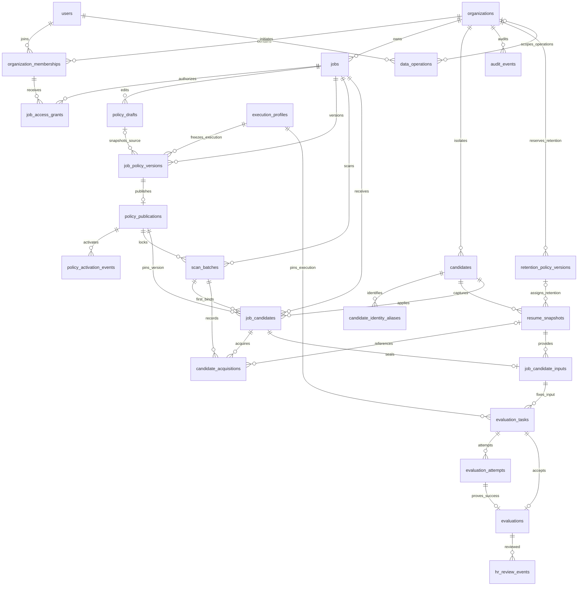

# Phase 1.7 Stage 2：SQLite 持久化层实施与验收

日期：2026-11-14。依据：[Stage 1 代码审计](../phase1_7_stage1/code_audit.md)、[数据库设计](../phase1_7_stage1/database_design.md)及用户补充的扫描批次方案 A。

## 1. 交付边界

本阶段实现标准库 sqlite3 业务库、实际版本化 Migration、Repository、授权检查、数据库级历史不可变约束及 ScanBatch。现有四级算法、Pydantic 契约、config.json、JSON ScoringCache 和原有测试保持；未调用真实 Qwen/BGE，未导入旧缓存，未开发前端、浏览器、发送或 JD Compiler。

需要明确：旧评分 CLI 仍沿用原来的配置与缓存路径。新 Repository 可创建、绑定和保存业务事实，本阶段没有自动把旧 evaluate(resume) 流程改成数据库任务 worker。后续接入必须先读取封存输入和绑定版本，不能读取岗位当前配置替代旧版本。数据库内的版本冻结不能倒推为旧 CLI 已完成多岗位调度。

## 2. 新增与修改文件

| 文件 | 内容 |
| --- | --- |
| `storage/database/__init__.py` | 导出 Database、DatabaseError、MigrationError |
| `storage/database/connection.py` | 文件连接、连接参数验证、Migration、完整性/漂移检查 |
| `storage/database/transaction.py` | BEGIN IMMEDIATE、提交/回滚与嵌套 savepoint |
| `storage/database/migrations/__init__.py` | 连续版本加载、SHA256、逐语句执行和 Schema 指纹 |
| `storage/database/migrations/001_identity_policy.sql` | 组织、人员、岗位权限、草稿、不可变配置及发布/激活事实、审计 |
| `storage/database/migrations/002_candidates_batches.sql` | 候选人身份、简历快照、扫描批次、岗位关联、采集、封存输入 |
| `storage/database/migrations/003_evaluations.sql` | 任务、尝试、正式结果、HR审核及保存期限/数据操作预留 |
| `storage/database/migrations/004_business_guards.sql` | 发布门控、批次锁版本、生命周期、完整输入及成功尝试约束 |
| `storage/database/migrations/005_immutable_guards.sql` | 历史 UPDATE/DELETE/REPLACE 防护、可变表绑定字段冻结 |
| `storage/models/__init__.py`、`context.py` | 可信业务访问上下文和部署初始化上下文 |
| `storage/repositories/__init__.py` | 聚合 RecruitmentRepository |
| `storage/repositories/base.py` | 事务内授权、组织/岗位权限、规范 JSON/哈希和审计 |
| `storage/repositories/identity.py` | 用户/组织初始化、成员、岗位、授权和审计读取 |
| `storage/repositories/policies.py` | 草稿修订、执行快照、每岗位版本、显式确认与发布 |
| `storage/repositories/batches.py` | 批次创建、读取和合法状态切换 |
| `storage/repositories/candidates.py` | 身份去重、批次采集、快照追加、首次输入封存和授权读取 |
| `storage/repositories/evaluations.py` | 固定输入任务、失败/成功尝试、正式评分、HR审核和读取 |
| `storage/database_cli.py` | db-init/db-check/db-migrate 的参数、JSON结果与错误退出 |
| `main.py` | 增加三个数据库子命令，保留原命令分发 |
| `.env.example` | 独立业务库路径与 busy_timeout 环境配置 |
| `.gitignore` | 默认业务库及 WAL/SHM 不纳入源码 |
| `README.md` | 运行命令、业务库入口和本阶段接入边界 |
| `tests/database_support.py` | 实际迁移和 Repository 的独立临时文件库 fixture |
| `tests/test_database_infrastructure.py` | 连接、原子迁移、并发初始化、漂移、重启、事务验证 |
| `tests/test_database_identity_policy.py` | 组织/岗位授权、独立版本、草稿确认和不可变约束 |
| `tests/test_database_candidates.py` | C方案、批次、简历、跨岗位读取和并发绑定验证 |
| `tests/test_database_evaluations.py` | fast/deep、失败、证据、历史不可变和HR审核验证 |
| `tests/test_database_cli.py` | 真正子进程CLI与冷启动Repository读取 |
| `tests/database_acceptance.py` | 分组运行原90项和数据库测试，核对Stage 1文件哈希，保存日志 |
| `reports/phase1_7_stage2/` | 本报告、自动验收摘要/日志、真实CLI结果与数据库结构清单 |

没有增加依赖。Stage 1 的源码清单共43个文件；本阶段允许修改其中 main.py 和 README.md，其余41个逐文件 SHA256 核对见 [test_summary.json](test_summary.json)。

## 3. 最终数据库 ER

实际有24张业务/支持表，另有1张 schema_migrations。下图为关系概览，实际外键均包含相应 org_id、job_id、candidate_id 等作用域字段。



jobs.current_policy_id/current_policy_version 通过复合外键指向已发布版本；scan_batches 同样直接引用 publication。job_candidates 的首次批次外键还包含 policy_id/policy_version，后续 acquisitions 的 batch_id 独立引用批次，允许旧 V1 候选人出现在 V2 批次中而不改绑定。

## 4. Migration 与连接

| 版本 | 作用 |
| --- | --- |
| 001 | 身份、权限、岗位和配置版本 |
| 002 | 批次、身份别名、快照和评分输入 |
| 003 | 任务/结果及工程化预留 |
| 004 | 业务门控与生命周期 |
| 005 | 防覆盖与不可变保护 |

每个连接设置并验证 `foreign_keys=1`、`recursive_triggers=1`、`journal_mode=wal`、`busy_timeout=5000`（可配置1–60000ms）。使用 synchronous=NORMAL。WAL初始化锁竞争有受限重试，不无限等待。每个 Repository 操作独立打开/关闭连接。

全部待执行迁移在同一个 BEGIN IMMEDIATE 中应用，连同DDL、schema_migrations及user_version一起提交。不用会隐式提交的 executescript。失败时整体回滚；首次失败不留下表或账本，升级失败保留原库和原数据。重复启动只验证，不重复应用。

已应用SQL的文件名、版本与SHA256必须相符；Schema指纹检查表、索引和触发器漂移。发现无账本的非空数据库、历史SQL变化或触发器被删除时明确失败，不静默修复。后续升级应新增006等版本，不能改已部署001–005。

```powershell
python main.py db-init
python main.py db-check
python main.py db-migrate
python main.py db-check --database D:/private/recruitment.sqlite3
```

路径优先级：`--database` > `RECRUITMENT_DB_PATH` > `data/recruitment.sqlite3`。相对路径以项目根目录解析，支持其他工作目录启动。`db-check`对缺失文件返回失败且不创建新库。结果为JSON；失败返回非零退出码。

## 5. Repository 接口与授权

入口：`RecruitmentRepository(Database(path))`。下面除bootstrap外，业务接口第一个参数都是可信 `AccessContext(org_id,user_id)`。

| 职责 | 接口 |
| --- | --- |
| 部署初始化 | `create_user(system, auth_subject, ...)`、`create_organization(system, name, owner_user_id, ...)`；system为ProvisioningContext |
| 组织人员 | `add_organization_member(ctx, user_id, org_role=...)`、`set_member_state(ctx, user_id, state)` |
| 岗位 | `create_job(ctx,title,...)`、`get_job(ctx,job_id)`、`list_jobs(ctx)` |
| 岗位授权 | `grant_job_access(ctx,job_id,user_id,permissions=...)`、`revoke_job_access(...)` |
| 执行上下文 | `create_execution_profile(ctx,profile_json,...)`、`get_execution_profile(ctx,profile_id)` |
| 草稿 | `create_policy_draft(ctx,job_id,policy_json,...)`、`update_policy_draft(...,expected_revision=...)`、`get_policy_draft(...)` |
| 配置版本 | `create_policy_version(ctx,job_id,policy_json,execution_profile_id=...,...)`、`publish_policy(...,confirmation_hash=...)`、`get_current_policy(...)`、`get_policy_version(...,policy_id或policy_version)` |
| 批次 | `create_scan_batch(ctx,job_id,...)`、`get_scan_batch(ctx,job_id,batch_id)`、`transition_scan_batch(...,status)` |
| 采集 | `acquire_candidate_for_job(ctx,job_id,batch_id,candidate_key,...)` |
| 快照/封存 | `append_resume_snapshot(ctx,job_id,job_candidate_id,resume,batch_id=...)`、`seal_candidate_input(...)`、`get_resume_snapshot(...)`、`get_sealed_input(...)` |
| 候选读取 | `get_job_candidate(ctx,job_id,job_candidate_id)`、`list_candidate_acquisitions(...)` |
| 评分任务 | `create_evaluation_task(ctx,job_id,job_candidate_id,scoring_mode,...)`、`get_evaluation_task(...)` |
| 尝试/结果 | `append_evaluation_attempt(...,status,error_type=...,response=...,metrics=...)`、`save_evaluation(...,result,attempt_id=...)`、`list_evaluation_attempts(...)`、`get_candidate_evaluations(...)` |
| HR/审计 | `append_hr_review(ctx,job_id,evaluation_id,action,reason=...)`、`list_audit_events(ctx)`（组织管理员） |

授权与业务SQL处于同一事务快照中。组织、用户、成员必须ACTIVE。ORG_ADMIN管理本组织；普通HR只读取有有效view授权的岗位。岗位创建人默认具备该岗位全部权限，其他HR必须显式授权。权限分为view/edit/publish/collect/evaluate/review/export/manage_grants；业务写入检查对应权限。撤销授权后下一次读取立即拒绝。

简历读取还必须存在该岗位、该关联的 acquisition，不能仅凭同组织 candidate_id 读取该人在其他岗位采得的简历。跨组织、跨岗位错误引用由复合外键拒绝。

AccessContext是后端内部授权上下文，本身不是登录凭据；ProvisioningContext只用于受控部署初始化，不是HR自助越权接口。本阶段没有HTTP端点。SQL连接、tx/read扩展钩子及数据库文件只供可信后端，不应透传前端。

## 6. 版本绑定与封存

创建策略版本时，在写事务内分配该岗位MAX(version)+1，同时推进next_policy_version。版本一经封存即不可变，未发布版本也不能就地改内容。发布是单独事务，验证确认哈希、当前草稿revision、完整来源、诊断、发布权限及版本前进，然后由触发器同时追加publication、activation event并更新current指针。

手工快照确认 `policy_hash`；来源于草稿的版本必须确认 `source_draft_hash`（source + policy + diagnostics），不能用相同policy_json的旧确认值。版本保存完整 `source_snapshot_json`、原始JD/HR文本和执行快照引用，不仅保留来源哈希。草稿后续可改，历史来源仍在版本中。

批次及采集顺序：

1. create_scan_batch 在BEGIN IMMEDIATE中读取该岗位当前publication，存入batch policy_id/version。
2. Batch-001锁V1；即使其执行期间发布V2，Batch-001的新候选人仍绑定V1。
3. 新建Batch-002才读取V2，其首次新候选人绑定V2。
4. 旧V1候选人进入Batch-002只追加acquisition，原job_candidate和输入保持V1。
5. 部分/失败简历不封存；第一次采到完整、可评分、无采集或映射问题的简历时，封存输入。
6. 已封存后，后续简历仅追加/复用内容相同的快照，不替换评分输入。
7. 任务由封存输入及其policy.execution_profile创建，绝不读jobs.current替代。

批次合法生命周期为 RUNNING→PAUSED/COMPLETED/CANCELLED，PAUSED→RUNNING/COMPLETED/CANCELLED；终态不能恢复。恢复读取同一批次行，不重新绑定配置。只有RUNNING批次、OPEN岗位可以采集。

并发发布和批次创建通过BEGIN IMMEDIATE串行化：先提交发布则批次锁V2；先创建并提交批次则保留V1。两个方向都有实际双连接受控并发Repository测试。

## 7. 不可变评分和数据库约束

历史策略、执行上下文、publication/activation、候选身份、简历、岗位候选关联、封存输入、采集事件、已完成尝试、正式结果及HR审核事实都具有UPDATE/普通DELETE保护。可变表的身份/绑定字段独立冻结。

不能只靠DELETE触发器防INSERT OR REPLACE：所有受保护的唯一键还具有BEFORE INSERT冲突检查，在SQLite准备删除旧行前拒绝。测试在recursive_triggers=0和1两种设置下验证历史评分及策略均不能替换；应用连接仍强制开启递归触发器。

正式评分字段包括org/job/candidate/job_candidate/policy_id/policy_version/resume/task/attempt/evaluation/profile、mode/status/final_score、Tier0/1/2、维度、证据、完整结果JSON及创建时间/人。版本信息保留在不可变profile与结果version_info中。

数据库唯一约束确保同岗位候选人每个scoring_mode只有一份任务和正式结果。fast/deep可各有一份。失败只能追加FAILED attempt并记录失败类型/指标；不能写成DEEP_SCORED。正式结果必须关联本任务已接受的SUCCEEDED attempt，且结果JSON一致。HR审核另表追加，不能改模型评分。

Repository继续使用现有Pydantic契约，核对候选key、简历哈希、配置哈希、模式、可选执行版本、完整性、原文引用、四维加权及AUTO条件。拒绝cache_hit结果和仅Tier3诊断结果导入正式评分。SQL负责外键、状态、非空深度分数、JSON与列一致及不可变，原文语义校验仍由可信Repository负责。

## 8. 自动验收结果与覆盖

可重放命令：`python -X utf8 -m tests.database_acceptance`。日志：[原回归](original_regression.log)、[数据库集成](database_integration.log)、[结构化摘要](test_summary.json)。本报告不使用Stage 1的38项样机结果替代本次验收。

| 组别 | 通过/执行 | 失败 | 错误 | 跳过 |
| --- | --- | --- | --- | --- |
| 原有离线回归 | 90/90 | 0 | 0 | 0 |
| 数据库基础设施 | 14/14 | 0 | 0 | 0 |
| 组织授权/配置版本 | 12/12 | 0 | 0 | 0 |
| 批次/候选人/简历 | 17/17 | 0 | 0 | 0 |
| 评分持久化 | 11/11 | 0 | 0 | 0 |
| CLI/独立进程持久化 | 5/5 | 0 | 0 | 0 |
| 合计 | 149/149 | 0 | 0 | 0 |

验收用真实迁移文件和真实Repository，临时文件库相互独立。评分结果fixture采用明确的离线Mock引擎，用于持久化/证据约束测试，不代表真实模型效果；没有真实API请求。

| 用户验收项 | 实际测试定位（tests下） |
| --- | --- |
| 首次/重复Migration、重启、FKcheck | test_database_infrastructure / test_database_cli |
| 一个HR多岗位、多个HR授权、组织隔离 | test_database_identity_policy：private_jobs、tenant_context；test_database_candidates：cross_organization |
| V1发布、A绑定、V2发布、A不变、B用V2 | test_database_candidates：batches_lock_versions_and_existing_candidates_keep_original |
| 未评分A、简历补全仍V1、封存不覆盖 | candidates：partial_completion_is_sealed_once；evaluations：task_created_after_new_publication |
| 历史评分UPDATE/DELETE/REPLACE拒绝 | evaluations：direct_sql_cannot_update_delete_or_replace_official_result、second_official_result |
| 跨岗位policy/跨组织candidate拒绝 | identity_policy：cross_job_publication；candidates：database_rejects_batch_rebinding、cross_organization |
| fast/deep分别保存、失败不得伪造 | evaluations：fast_and_deep_records、failed_attempt、database_refuses_formal_score_attached_to_failed_attempt |
| 两种提交顺序并发写入绑定 | candidates：concurrent_publish_before_batch、concurrent_batch_before_publish |
| Batch-001/V1发布V2后仍V1；Batch-002/V2；重复A仍V1 | candidates：batches_lock_versions_and_existing_candidates_keep_original |
| 批次重启恢复、禁止改policy、跨岗位/组织配置 | candidates：restart_and_resume_batch、database_rejects_batch_rebinding、cross_organization |
| 同candidate跨岗位简历读取隔离、撤权即拒 | candidates：resume_reads_require_acquisition_by_the_requested_job、acquisition_reads_recheck_revoked_access |
| 完整草稿确认、来源封存 | identity_policy：confirmation_cannot_be_reused、published_version_retains_original_source |

## 9. 实际初始化与重启验证

默认独立业务库 `data/recruitment.sqlite3` 已通过统一CLI首次初始化；未灌入测试用户、候选人、旧JSON缓存或伪造正式评分。初始化、另进程检查与重复迁移输出分别保存在 `database_init.json`、`database_check.json`、`database_migrate.json`，结构元数据见 `schema_inventory.json`。

数据库重启数据留存不是只检查空文件：`ColdProcessPersistenceTests`先通过Repository写入V1、Batch-001、候选人A，发布V2后启动全新Python子进程，重新构造Database/Repository。读取结果为current=policy2、batch=policy1、candidate=policy1、check=true。另有已保存fast/deep结果重新打开数据库后保持一致的测试。

真实CLI检查要求：schema_version=5，foreign_keys=1、recursive_triggers=1、WAL、busy_timeout=5000；integrity_check=ok，foreign_key_violations为空，无待迁移。

## 10. 设计调整、未实现项与限制

实施中发现并修复的技术问题：

- Stage 1样机将首次候选绑定jobs.current；用户已明确补充方案A，因此改为first_batch.policy。已有候选人在新批次中必须允许保留旧policy，不能误设每条acquisition的policy必须等于候选绑定。
- 草稿完整哈希与policy-only哈希不同，发布门控已分开；相同策略、不同来源不能复用确认。
- 来源草稿可编辑，不能只存其哈希；版本新增完整source_snapshot_json并冻结原始JD/HR文本。
- SQLite REPLACE和递归触发器存在特殊行为，因此增加独立INSERT冲突保护；不只依靠普通DELETE保护。

保留的阶段边界：

- Stage 3通用Policy Schema、语义/执行能力验证、编译事实与完整确认工作流未实现。当前版本是可审计存储快照协议storage_snapshot_v1/legacy_ai_v2；任意存储JSON不等于已经编译为可执行通用策略。正式结果持久化只接受现有V2可执行结构和四维契约。
- Stage 5 Embedding资产表/向量仓库没有实现。原始锚点文本仍在不可变policy_json内；配置和执行/模型版本保留，未以向量替代配置。后续发布资产门控应以新Migration接入。
- retention_policy_versions、resume.retention_version_id和data_operations预留组织范围、保存规则、完整导出/备份/恢复/清理操作元数据。管理员配置接口、真实导出包、在线backup/restore和受控清理worker尚未实现；普通DELETE继续禁止。不能把元数据表称为已经可用的备份功能。
- 没有登录/HTTP服务，AccessContext必须由后续认证后端构建；SQLite文件所有者可修改Schema，数据库触发器不是针对文件所有者的安全隔离。Schema漂移可检测，不能宣称文件不可篡改。
- 模型别名或UNPINNED版本不能保证供应商底层模型不变；历史事实固定不等于未来真实模型调用必然产生相同分数。
- JSON缓存继续独立存在且可覆盖；没有正式评分导入通道。旧CLI不受DB保护的单机行为仍保留，后续任务worker接入时必须按封存输入读取。

Stage 2到此停止，等待人工验收，不进入Stage 3。
