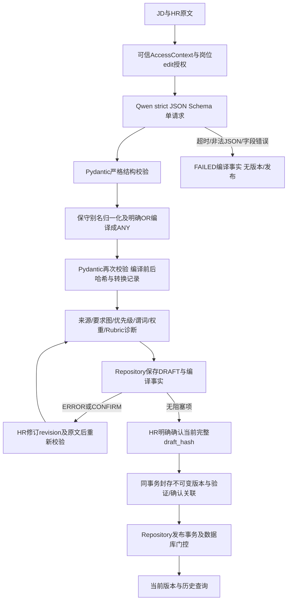

# Phase 1.7 Stage 3：通用 Job Policy Compiler 交付报告

日期：2026-11-14。依据 Stage 1 审计/设计及已验收 Stage 2。只交付编译、校验、草稿、确认和发布；未改造候选人评分算法。

## 1. 结果与边界

已实现岗位无关的结构化策略编译器，不是只生成Prompt。真实Qwen输出经过闭合JSON Schema、Pydantic、引用图/来源/优先级/权重/Rubric等静态分析，再通过Repository创建DRAFT。发布需要当前完整草稿哈希、成功验证事实及HR确认，数据库对通用协议强制门控。

AI自动化、Java后端、企业销售三份**合成JD输入**均取得真实 `qwen3.8-27b` 响应，生成了不同的硬条件、能力图、关键词、锚点、动态维度、Rubric和权重。输入不是外部招聘网站的真实职位；输出和调用指标是真实API结果。三份最终配置已用最新校验器再次离线复验，均可进入HR确认流程，**尚未发布**。

原90项 + Stage 2的59项 + 新增105项 = **254/254通过，无失败、错误或跳过**。本阶段没有调用BGE或对候选人运行真实Tier 3；没有把Mock结果作为真实配置。

通用Policy是供后续解释器消费的声明式协议。现有V2评分器仍使用固定AI四维和旧config.json，不能直接执行这些通用配置。本阶段没有借兼容适配提前修改Tier算法。

## 2. Schema与执行语义

权威类：[schemas/job_policy.py](../../schemas/job_policy.py)。完整机器Schema：[JobScoringPolicy.schema.json](JobScoringPolicy.schema.json)。所有岗位使用同一套类和JSON Schema，动态内容是ID与数组元素，不为岗位生成Pydantic类。

| 稳定外层字段 | 内容 |
| --- | --- |
| schema_version | `job_scoring_policy_v1` |
| job | title、summary |
| sources | JD和HR补充原文，必须与输入逐字一致 |
| requirements | requirement_id、label、source_type、source_text、priority、requirement_type、needs_confirmation |
| requirement_groups | group_id、ALL/ANY、成员ID、priority及来源；可引用原子或其他组 |
| hard_filters | 原子requirement引用、有限字段/运算符、类型化比较值、周期及UNKNOWN=REVIEW |
| keyword_groups | 能力类别、原子要求引用、canonical/aliases/weight |
| semantic_anchors | 原文锚点文本、正/负极性、原子要求引用；没有存向量 |
| scoring_dimensions | 动态dimension_id/label/description、原子要求引用、weight、Rubric区间 |
| thresholds | coarse_pass、deep_review、deep_recommend，均0–100 |
| diagnostics | code、ERROR/CONFIRM/WARNING、message、关联要求ID |
| provenance | compiler/prompt/validator/model版本 |

Source类型：JD、HR、INFERENCE。优先级：REQUIRED、PREFERRED、OPTIONAL。要求类型是通用SKILL/EXPERIENCE/EDUCATION/LOCATION/COMPENSATION/RESPONSIBILITY/OTHER，没有agent、rpa、java、sales等岗位专属字段。

要求关系是有限无环图：所有requirement/group ID处于同一命名空间，未知引用、重复ID及环均报错。未被其他组引用的节点是根；REQUIRED根按ALL成立，ANY仅要求一个分支成立。ANY分支内的REQUIRED表示选中分支内必需，不能把所有路线叶子再全局AND。PREFERRED/OPTIONAL不成为硬拒绝条件。证据投影只引用原子要求，不引用组。

HardFilter白名单：education_level、work_years、expected_salary、city、work_authorization、job_status；运算符EQ/NE/GTE/LTE/IN/EXISTS。它们是图中原子条件的谓词投影，未来执行器需保留要求图的关系。缺失数据只REVIEW，不默认通过或拒绝。

本协议v1薪资数统一人民币千元K，unit保留month/year/day/hour；工作年限用year，学历用level。外币或缺少周期时产生待确认诊断，不能擅自执行预算比较。不支持的必需OTHER要求必须确认，不生成任意代码。字段白名单是当前可解释能力边界，不代表任意自然语言条件都已有执行器。

DynamicPolicyAssessment也是稳定数组协议；输出维度ID必须与Policy集合精确一致，拒绝缺失、重复或额外维度。这里只验证协议，没有改造Qwen候选人评分调用。

## 3. 编译流程与Prompt



组件：

- `JobPolicyCompiler`负责请求、响应解析、服务端版本标注和诊断，无数据库或发布权限。
- `PolicyCompilerService`编排外部请求与Repository。请求前检查权限，持久化时再次检查，不在SQLite写事务内等待模型。
- `policy_normalization`执行确定性编译处理；`policy_validation`负责静态分析。两个模块均无数据库、模型或网络依赖。
- `CompilerRepository`保存不可变编译/验证事实、HR确认及版本关联；原PolicyRepository继续负责草稿、版本和发布。

模板源码：[config/prompts/job_policy_v1.txt](../../config/prompts/job_policy_v1.txt)，当前版本 `job-policy-prompt-v1.3`；交付快照：[job_policy_prompt_v1_3.txt](job_policy_prompt_v1_3.txt)。每次真实诊断目录保留对应Prompt、Schema、输入、原始响应和指标；最终AI/销售使用v1.2，Java重试使用v1.3，provenance分别保留，没有冒充同一版本生成。

当前编译版本job-policy-compiler-v1.1、校验版本policy-validator-v1.1、语义编译处理policy-normalizer-v1。它们并非把模型JSON原样换个文件名：未知同义词被剔除并记录原始值，明确的两项ASCII名称替代被编译为ANY图，同时调整所有原子证据投影引用。输入对象、JD/HR原文、权重、Rubric和硬过滤不变。

别名只有NFKC/大小写/空白等同名变体，或原输入明确的“全称（简称）/又称”证据才能保留；同文出现两个工具不构成同义证据。保守处理会减少部分常用但无明示来源的缩写召回。多项替代、英文prose歧义、混合AND或硬过滤复合引用不会猜测处理，会阻塞发布。Repository校验也检查未处理的alias/OR，不能手写JSON绕过编译步骤。

原始Qwen响应始终单独保存；metrics记录raw_response_sha256、compiled_policy_sha256、normalizer_version和逐项normalization_actions。最终三份配置已验证能由对应真实响应重复执行纯编译步骤精确得到，没有用手工改JSON冒充模型响应。

JD/HR作为user中的untrusted_job_input JSON传入，system规定来源、结构和安全边界。输入中的改身份、跳过Schema、泄漏信息、自动发布等指令不能授予权限。硬条件必须有明确原文，偏好不得硬化；不同替代能力不能当同义词。所有锚点包括负向锚点均要有非空原子要求引用。

## 4. 校验与诊断

结构校验保留extra=forbid、strict类型、有限值、全字段required和nullable显式值。所有JSON对象additionalProperties=false。范围、长度、字段类型或非法JSON错误不进行宽松修复；请求结束也不能绕过Pydantic。

确定性业务分析包括：

- 原始输入与策略sources/title一致；JD/HR引用必须是对应原文的非空连续片段，推断不得伪造引用。
- REQUIRED ALL/ANY不能提升加分项；明确“至少一条”不能降成偏好或改ALL。
- 原子/组/维度/锚点/过滤器等ID唯一，引用有效、图无环。
- 客观条件的要求类型、值类型、单位及原文数值匹配；工资小数、万/元/K归一验证；明确单向上下界反转报错；冲突上下界不能发布。
- INFERENCE、来源含糊和未解决needs_confirmation产生CONFIRM；本版不提供绕过开关。HR需通过补充明确要求、修改草稿/来源形成新revision，再验证。
- 动态维度权重总和为1；Rubric整数区间无漏段、重叠，完整覆盖0–100；深度核验阈值不高于推荐阈值。
- 明确评价候选年龄、性别、婚育或预测主观稳定/留任的维度拒绝；客户画像、客户关系或服务稳定性不会仅因出现同词被拒绝。

ERROR/CONFIRM阻止确认和发布。WARNING可保留。模型自报diagnostics不能压制确定性诊断。静态分析不能证明自然语言语义完全正确或没有遗漏，人工完整哈希确认仍必需。

## 5. Repository与数据库集成

所有业务持久化调用Repository，没有用Compiler直接执行SQL。新增表：

| 实体 | 保存内容与约束 |
| --- | --- |
| policy_compilation_runs | 原输入/hash、关联草稿revision/fullhash、Policy JSON/hash、LLM或VALIDATION类型、parent_run、成功/失败、诊断、四版本、metrics、失败类型 |
| policy_confirmations | 同一成功run、当前draft/revision/fullhash及policy_hash、明确确认人/时间 |
| policy_version_compilations | 不可变版本与精确run/confirmation的关联 |

新增API：`record_policy_compilation`、`get_policy_compilation`、`list_policy_compilations`、`confirm_policy_draft`、`get_policy_confirmation`、`attest_policy_version`。每一步都重新核对组织/岗位权限、来源、当前revision/hash和业务校验，不能仅传diagnostics=[]取得成功。

服务API：`compile_draft`、`update_draft`、`confirm_draft`、`create_version`、`publish_version`。编辑稿记录VALIDATION run，父run必须属于同一草稿且更早revision；不能把另一个草稿的调用拿来伪造来源链。版本创建与验证/确认关联在同一事务完成，确认失效会整体回滚、不消耗版本号。

继续复用Stage 2完整哈希与source_snapshot_json。通用版本必须用匹配的job_scoring_policy_v1协议；发布时数据库要求成功编译记录、精确草稿来源/hash和HR确认。权重总和与维度唯一还有SQL第二道校验。发布后的配置、编译事实、确认和关联均防UPDATE/DELETE/REPLACE，且不改变历史候选人的版本绑定。

Migration只追加：006_policy_compiler.sql新增表及发布门控；007_compiler_lineage.sql追加同草稿来源链保护。006已经用于初轮真实诊断后发现来源链缺口，因此通过007修补，没有回头改已应用的006。001–005未修改。默认业务库5→7升级和所有真实诊断库升级均通过；输出见[数据库迁移](database_migrate.json)、[检查](database_check.json)、[诊断库检查](live_database_checks.json)。

Stage 2原测试中的版本=5、applied数量=5及故障注入006硬编码改为最新Migration动态值；用例数量和业务断言全部保留，59项实际运行在版本7，没有用只迁移到旧版本的方式制造通过。

## 6. 运行与人工发布

```powershell
python main.py db-migrate
python main.py policy-schema --output reports/policy_schema.json
python main.py policy-validate --policy reports/phase1_7_stage3/policies/java_backend.json
python -X utf8 -m tests.policy_acceptance
```

真实三岗位诊断（合成输入、独立诊断数据库、只创建草稿）：

```powershell
python main.py policy-diagnose --live --label review_001
```

已有组织/人员/岗位由可信部署流程创建，input.json字段为job_title、jd_text、hr_requirements。以下ORG/USER/JOB等替换成自己的已授权记录，逐步检查每次返回值：

```powershell
python main.py policy-compile --live --input input.json --org-id ORG --user-id USER --job-id JOB
python main.py policy-draft --draft-id DRAFT --org-id ORG --user-id USER --job-id JOB
python main.py policy-confirm --draft-id DRAFT --run-id RUN --confirm-hash FULL_DRAFT_HASH --org-id ORG --user-id USER --job-id JOB
python main.py policy-version --draft-id DRAFT --run-id RUN --confirmation-id CONFIRMATION --execution-profile-id PROFILE --org-id ORG --user-id USER --job-id JOB
python main.py policy-publish --policy-id POLICY --confirm-hash FULL_DRAFT_HASH --org-id ORG --user-id USER --job-id JOB
python main.py policy-current --org-id ORG --user-id USER --job-id JOB
python main.py policy-history --version 1 --org-id ORG --user-id USER --job-id JOB
```

`policy-update`要求policy文件、expected-revision和parent-run-id，可同时提供source-input；`policy-runs`读取编译事实。各命令支持--database/--output/--help。这些是可信本地管理命令，org/user参数不是HTTP认证凭证，不应直接暴露给前端。没有自动替HR确认或发布的默认行为。

## 7. 三份真实完整配置与差异

输入：[tests/fixtures/job_compiler_inputs.json](../../tests/fixtures/job_compiler_inputs.json)。输出：

- [AI自动化应用开发完整Policy](policies/ai_automation.json)
- [Java后端完整Policy](policies/java_backend.json)
- [企业客户销售完整Policy](policies/b2b_sales.json)

完整结构、原文、能力图、全部关键词/锚点、逐维Rubric与引用都在上述JSON中；[live_acceptance.json](live_acceptance.json)保留来源路径、内容SHA256、最新校验及岗位差异断言。

| 内容 | AI自动化 | Java后端 | 企业销售 |
| --- | --- | --- | --- |
| 客观硬条件 | 大专及以上、月薪≤18K | 本科及以上、工作≥3年、月薪≤30K | 工作≥2年、月薪≤20K；无学历门槛 |
| 主要能力 | Python、异常处理/接口测试，应用或网页自动化路线 | Java、SQL/事务、接口测试，Spring Boot或Quarkus | 需求访谈、谈判、漏斗、可核验签约/回款，直销或渠道 |
| REQUIRED ALL/ANY组数 | 3 / 3（含两组工具级OR） | 1 / 1 | 1 / 1 |
| 关键词数/锚点数 | 12 / 4 | 12 / 3 | 8 / 4 |
| 动态维度 | 应用交付/可靠性/提效/需求理解 | 服务设计/数据正确性/排障/测试/业务沟通 | 客户开拓/方案沟通/商务推进/回款管理 |
| 权重 | 50/25/15/10 | 30/30/20/15/5 | 25/20/35/20 |
| 粗排/核验/推荐阈值 | 52/68/90 | 60/72/92 | 48/65/88 |
| 最新诊断 | 11条WARNING | 11条WARNING | 8条WARNING |

权重和阈值在合成HR输入中明确指定，证明编译器遵循输入；不是修改了评分引擎默认权重。加分项分别为Docker/n8n、Kafka/Kubernetes、CRM/英语，均未成为硬过滤。Java/销售关键词无Agent/RPA污染。每个岗位Rubric结合其维度生成，详见配置。

最终WARNING均是可见的编译转换记录：无明示同名证据的aliases剔除、AI两项工具OR编译，以及AI一项重复别名提示。没有ERROR/CONFIRM。重复提示不构成第二个能力，后续解释器仍需按canonical去重。未把这些WARNING隐瞒或改为“无问题”。

## 8. 真实Qwen调用指标与失败记录

配置：`qwen3.8-27b`、temperature=0、timeout=90s、max_tokens=12288、enable_thinking=false、SDK max_retries=0、strict json_schema。90秒为有界的策略生成预算，响应约4–5千Token；没有无限增加超时、关闭Schema或自动修复JSON。

最终接受的三份：

| 岗位/Prompt | 总耗时秒 | 输入Token | 输出Token | 总Token | finish_reason | 结构/业务 |
| --- | --- | --- | --- | --- | --- | --- |
| AI / v1.2 | 83.9986 | 4540 | 4646 | 9186 | stop | 严格结构、编译、业务通过，保留WARNING |
| Java / v1.3 | 87.2511 | 4630 | 4497 | 9127 | stop | 严格结构、编译、业务通过，保留WARNING |
| 销售 / v1.2 | 73.0709 | 4520 | 3993 | 8513 | stop | 严格结构、编译、业务通过，保留WARNING |

供应商全部返回reasoning_tokens=null，表示未知，不能记成0。模型返回别名不证明底层修订固定。

失败也完整保留，未记为通过：

| 记录 | 结果及后续 |
| --- | --- |
| initial_ai | 0.1434s APIConnectionError，未收到供应商响应，无Token用量；首轮指标未保存底层连接原因 |
| live_ai_v1 | 67.5530s，4244输入+4065输出=8309Token；strict/Pydantic通过，但硬条件引用缺强制上下文，必需路线降为偏好，业务验收失败 |
| full_v1_1/java_backend | 75.3138s，4438输入+4790输出=9228Token；模型stop但负向锚点requirement_ids为空，Pydantic拒绝，保存FAILED run，不创建版本 |
| normalized_v1_2/java_backend | 90.0107s APITimeoutError，无响应与usage，保存FAILED run；没有增加90秒上限 |

早期结构校验通过的AI/Java/销售输出在语义复核中仍发现问题：JUnit/TestNG、Kubernetes/Docker等不同工具被放入aliases，AI工具级OR留在原子自然语言中。因此这些早期配置不作为最终交付。修复包含别名证据门控、显式OR编译、相应Repository lint和反例测试；最终重新运行三岗位真实请求，没有仅修改旧输出后宣称新请求成功。

其他修正是加强Prompt的强制上下文/REQUIRED ANY和锚点引用约束。Java超时后压缩Rubric与重复描述、别名输出冗余，保持同一90秒上限，下一次87.2511秒成功；没有足够观测将超时精确归因为推理、排队或网络层，不能声称根因已证明。没有降低严格校验或自动重试。所有原始响应位于live子目录，逐次指标汇总见[live_calls.json](live_calls.json)。

共收到8份真实API响应，最终选用当前完整编译流程的3份；早期5份保留为失败或被语义复核取代的记录。另有1次超时和1次连接失败未收到响应。8份返回usage的响应合计72088Token，最终接受三份共26826Token；无响应请求用量未知，不能视为0，也不推算费用。

## 9. 自动化测试及源码保护

重放：`python -X utf8 -m tests.policy_acceptance`。分组报告：[test_summary.json](test_summary.json)、[原90项](original_regression.log)、[Stage 2的59项](stage2_database.log)、[新增Compiler测试](compiler.log)。

| 组别 | 通过/执行 | 失败/错误/跳过 |
| --- | --- | --- |
| 原有评分回归 | 90/90 | 0/0/0 |
| Stage 2实际Migration/Repository | 59/59 | 0/0/0 |
| Policy Schema/静态诊断 | 36/36 | 0/0/0 |
| 三岗位离线配置与通用性 | 12/12 | 0/0/0 |
| Compiler传输与服务Mock | 13/13 | 0/0/0 |
| 新Compiler数据库集成 | 13/13 | 0/0/0 |
| 真实子进程CLI | 7/7 | 0/0/0 |
| 语义编译处理单测 | 14/14 | 0/0/0 |
| 独立语义编译集成复核 | 10/10 | 0/0/0 |
| 合计 | 254/254 | 0/0/0 |

Mock测试使用明确无网络的Fake client，验证完整编译→真实SQLite草稿/确认/发布链，覆盖超时、JSON/Schema错误、来源篡改、非法权重、ID重复、动态维度、ALL/ANY、加分项、冲突、旧确认失效、不可变和权限。真实Qwen测试是第8节的单独记录，不计入上述Mock测试。

initial_前缀日志是中间验证记录，不是最终通过数。初轮独立编译测试曾错误地要求拆分叶子的source_text仍为整句；实际协议是叶子保留原文连续工具名、父ANY保留原始整句。该断言已改为验证精确原文片段与父级来源，并补充引用完整性测试，最终24项语义编译相关测试全部通过。

Stage 1清单中除允许修改的main.py/README外，41个原文件SHA256均未变，包含全部四级算法、原Schema、config.json、JSON缓存实现和原90项测试。严格停止条件中列出的hard_filter.py、rule_matcher.py、semantic_ranker.py、llm_reviewer.py均未修改，未使用兼容适配例外。

## 10. 新增与修改文件

| 文件 | 职责 |
| --- | --- |
| 新增schemas/job_policy.py | 稳定通用Policy及动态评分输出协议 |
| 新增config/policy_compiler.py | Qwen请求、严格响应、版本及耗时/Token指标 |
| 新增config/policy_validation.py | 确定性业务分析与发布校验 |
| 新增config/policy_normalization.py | 保守同名处理、显式OR编译、审计及绕过lint |
| 新增config/policy_service.py | 草稿编排、修订、确认、原子版本、发布 |
| 新增config/policy_cli.py | 可信本地管理命令 |
| 新增config/prompts/job_policy_v1.txt | 版本化Prompt模板 |
| 新增storage/repositories/compiler.py | 编译、确认和版本关联Repository |
| 新增migrations/006_policy_compiler.sql、007_compiler_lineage.sql | 追加表及SQL门控，未改旧迁移 |
| 修改storage/repositories/__init__.py | 聚合CompilerRepository |
| 修改storage/repositories/policies.py | 通用协议分支验证、原文回填及同事务关联；旧分支保持 |
| 修改main.py | policy命令懒加载分发，保留旧入口 |
| 修改tests/test_database_infrastructure.py、test_database_cli.py | 迁移最新版本动态预期，保留原业务用例 |
| 新增tests/fixtures/job_compiler_inputs.json、tests/policy_fixtures.py | 三岗位合成输入和明确的离线fixture |
| 新增tests/test_policy_schema.py、test_policy_generality.py、test_policy_compiler.py、test_policy_persistence.py、test_policy_cli.py、test_policy_normalization.py、test_policy_normalization_integration.py | 新增105项自动化断言 |
| 新增tests/policy_live.py、policy_acceptance.py | 显式真实验收、分组离线验收 |
| 修改README.md、.gitignore | 使用说明与诊断DB排除 |
| 新增reports/phase1_7_stage3/ | Schema、Prompt、完整配置、真实响应、指标、测试及本报告 |

没有增加第三方依赖。旧config/job_compiler.py仍是AI岗位V2兼容入口，未删除或偷偷替换为通用策略；新入口是JobPolicyCompiler/PolicyCompilerService。

最终源码与测试输入指纹见[source_manifest.json](source_manifest.json)；最终三次真实Prompt快照已逐一与请求指标的prompt_hash核对相符。

## 11. 未解决问题与后续边界

- 通用Policy尚未接入四级候选评分执行器、Embedding资产或任务worker；这些属于后续阶段。不得将“可发布策略”误称为已经完成多岗位候选人评分。
- 静态分析只能验证有限语法、来源片段和明显冲突，不能证明LLM理解完整或派生关键词/Rubric语义与JD完全等价。生成内容仍需HR逐项审阅；最终Java输出包含微服务架构、单元测试、链路追踪等派生术语，它们不是原文硬条件，不应当作JD逐字明确要求。能力图保留原始Java必需要求，但派生关键词集合不保证逐词覆盖或等价于原文。
- 语义编译处理只自动解释有原文证明的两项ASCII命名替代；中文复杂复合要求、跨句隐含逻辑仍须Qwen提取和HR核验。不能以三岗位通过声称任意JD语义都已形式化证明。
- 真实编译延迟仍偏高且发生过90秒超时；没有自动重试或延长上限。下一步应另行观测供应商队列/首字延迟、生成速度与分阶段提取方案，本阶段不擅自加入更多模型调用或后台队列。
- 薪资v1仅规定人民币K；其他币种/不支持谓词须确认，不能靠猜测补充。数量与输入长度都有有界限制，不宣称无限复杂JD均可编译。
- ERROR/CONFIRM不能靠确认按钮绕过；需要HR明确补充或修订输入/策略后生成新revision和验证事实。尚无前端冲突解决界面。
- 草稿和编译记录分步写入；进程中断或并发修订可能留下尚无匹配验证的草稿，数据库会阻止其发布，后续需重新验证。没有覆盖历史评分的风险承诺之外的自动补偿worker。
- 旧storage_snapshot_v1/legacy发布兼容仍保留，不能声称所有旧手工JSON都已经过通用编译器校验。新服务/CLI始终使用通用协议。
- 敏感属性/主观稳定性检查是有限lint，不是对所有偏见语言的形式证明。模型别名UNPINNED、temperature=0也不保证未来输出逐字一致。
- 本地CLI依赖可信部署环境；尚未开发HTTP身份认证、前端、BOSS自动化或发送逻辑。Stage 2的保存期限、导出备份执行功能仍只预留，未借本阶段扩展。

实现参数选择参考[Qwen官方结构化输出说明](https://www.alibabacloud.com/help/en/model-studio/qwen-structured-output)。是否成功以本报告真实响应和本地严格校验为准，不以供应商宣称的strict模式替代验证。

Stage 3到此停止，等待人工验收。
