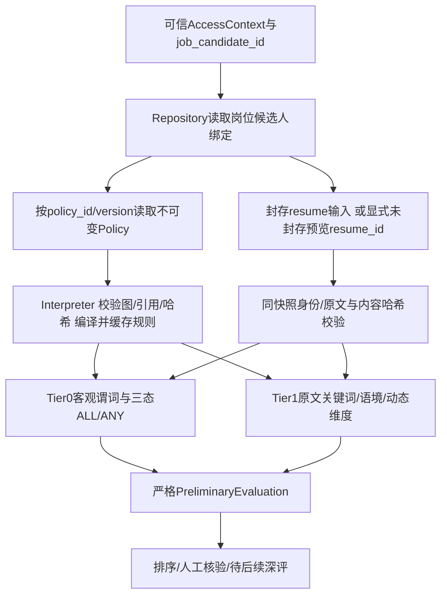

# Phase 1.7 Stage 4：Policy Interpreter 与通用初筛交付

日期：2026-11-15。范围：Interpreter、Tier 0、Tier 1及其只读初筛入口。未开发BGE匹配、Qwen终审、前端、浏览器或发送；未迁移JSON缓存为正式评分。

## 1. 审计、兼容决策与调用架构

实施前已完成[旧算法审计](legacy_audit.md)和[执行字段缺口/兼容设计](execution_design.md)。本仓库没有scoring_engine.py，旧实际调用入口是engine/hybrid_engine.py；报告没有引用不存在的代码。

旧Tier 0完整规则：最高明确学历、薪资下限/周期、求职状态排除、活跃状态允许列表、工作年限允许范围、历史职位核验线索，最后平面聚合FAIL优先、其次UNKNOWN。历史职位名称本来已不直接否决。未知学历、薪资等既有安全机制保留。

旧Tier 1完整机制：high/medium关键词合并，canonical/alias归一后每词只保留最大基础分；从职责、项目、毕设、工作标签、技能和优势中选最强来源；标签格式职责降权；按development_practice/engineering/efficiency三类别累计，贡献为cap×(1−exp(−raw/scale))，默认cap=28/12/5、scale=35/18/8，总上限45。旧粗排还要加55分BGE，深评则另用固定40/30/20/10四维。

保留旧模块和CLI以保证回归；新路径替换固定AI词表、固定类别/维度、单全局config和默认岗位条件，使用同一代码处理三岗位。



Interpreter不读jobs.current替代旧绑定、不调用模型、不持久化评分。服务每次检查组织/岗位score授权；缓存命中也重新经过Repository访问检查。封存输入不能通过传入新resume_id替换；部分简历只能显式预览，不能变成正式深评输入。

## 2. 未修改的协议与新增执行契约

JobScoringPolicy v1、ResumeData及既有正式EvaluationOutput均未修改。原因与兼容处理：

| 缺口 | 本阶段兼容方式 |
| --- | --- |
| keyword_groups是组级refs，没有逐词到原子要求的唯一映射 | 保留declared范围用于维度软信号；仅label唯一字面命中或source_text唯一回退建立precise关联。模糊关联出诊断，不能一次命中声称全组能力满足 |
| Policy无来源权重/词法语境/饱和尺度 | 独立版本化config/prescreen_profile.json；记录完整有效profile及hash，不伪称参数来自Policy |
| ResumeData无工作授权/现居城市 | 不增加会改变历史resume_content_hash的默认字段；严格ObjectiveFacts只读取同份raw snapshot白名单字段，缺失UNKNOWN。旧mapper的UNKNOWN_FIELD仍可见，并阻止READY |
| Policy无root_id | 按Stage3已确认约定：未被其他组引用的节点为根，多个REQUIRED根ALL |
| 旧粗排含BGE、新阶段只有规则 | 新score_kind=POLICY_TIER1_PRELIMINARY，0–100；不冒充旧coarse_score或正式深度分 |

新增严格契约在[schemas/prescreen.py](../../schemas/prescreen.py)，机器Schema见[PreliminaryEvaluation.schema.json](PreliminaryEvaluation.schema.json)。输出包含org/candidate/job/job_candidate、绑定policy与版本/hash、resume/hash、封存/预览来源、profile版本/hash、动态维度、命中/失败/未知要求、原文证据、图分支、review_reasons、阈值和明确状态。

每维有dimension_id/label/weight、raw_score、normalized_score、matched_requirements、evidence、missing_evidence以及预算M/B/质量。维度ID、标签和权重均核对绑定Policy，不固定AI四维或Java五维。

Interpreter完整保留Policy的Rubric供后续消费；本阶段规则分使用下述公开公式，不宣称已经按Rubric完成语义能力或Qwen终审。生效运行参数见[execution_profile.json](execution_profile.json)，本次profile_hash为`4b1d4d8f0e8a816b7cbeeb66371f4c425d7bf3058f098fe0e06b69112c9b59ce`。

Pydantic拒绝额外字段、非有限分数、越界值、重复维度、权重和不为1、顶层/阶段分数不同步、硬FAIL被改为READY、未知状态与硬状态矛盾、未封存预览伪装READY、虚构deep_score。所有证据再次核对原始快照路径和字符偏移。

## 3. Interpreter、规则缓存与历史绑定

入口为engine/policy_interpreter.py。load_for_candidate读取get_job_candidate与该关联的get_policy_version，核对id/version/protocol；从未调用get_current_policy。读取固定来源快照并验证Policy哈希。

编译产物为冻结dataclass/tuple及规范JSON快照，policy/profile属性返回独立模型，调用方修改返回模型不会污染缓存。alias等价簇只用最大Policy词权重，跨组重复不形成额外canonical。

缓存键包含org_id、job_id、policy_id、policy_version、profile_hash，满足版本复用并防止不同组织/岗位中相同p1/1串用。相同身份出现不同内容哈希会报错，默认LRU最多128项。授权与原始来源校验不会因缓存而跳过。缓存只含规则，不含候选人历史评分。

服务还复核Interpreter绑定与真实岗位候选行一致、snapshot身份一致、raw_hash和normalized内容哈希一致；损坏输入产生SCORING_FAILED且无初筛分，不把异常伪造为候选低分。

## 4. Tier 0字段与三态执行

字段仅education_level/work_years/expected_salary/city/work_authorization/job_status，运算符仅EQ/NE/GTE/LTE/IN/EXISTS；没有eval、生成代码、动态SQL或从任意简历文本推断事实。

| 字段 | 执行口径 |
| --- | --- |
| education_level | 统一degree与education[].degree，取最高明确等级；未知或无法统一需核验，不默认本科 |
| work_years | 点值、区间、以上/以内、明确零经验；无法解析/缺失UNKNOWN，不把应届自动当0 |
| expected_salary | 人民币K完整区间、月/年/日/小时周期，记录13薪但不跨周期换算；面议、外币、未知单位/周期UNKNOWN |
| city | 默认仅意向工作城市；可选profile current且需明确current_city原文。修饰性文本保守UNKNOWN，不猜现居地或地理层级 |
| work_authorization | 只接受原快照明确work_authorization及原文证明；不从国籍/年龄/优势推断 |
| job_status | 明确相同文本/有限同义状态可比较，未知别名UNKNOWN；仅离职不等于离职且立即到岗 |

区间比较取全区间确定性：GTE在lower≥门槛时PASS、upper<门槛时FAIL，跨界UNKNOWN；LTE相反。EQ/NE对跨越目标的范围不伪造点事实。EXISTS对可解析事实PASS，缺失/采集失败UNKNOWN。

同一requirement的多个谓词先ALL，再递归组图。ALL有FAIL即FAIL，全PASS才PASS，否则UNKNOWN；ANY有PASS即PASS，全FAIL才FAIL，否则UNKNOWN。

优先级与能力投影：PREFERRED/OPTIONAL不能硬拒，INFERENCE/needs_confirmation不能硬FAIL。纯能力根、ALL下无客观谓词的能力子树不参与Tier0；混合ANY中的无谓词分支保留UNKNOWN。例如ANY(学历FAIL,未评能力)必须UNKNOWN，不能删掉能力分支后误拒。Tier0 PASS只表示客观门槛通过，不能声称能力已全部验证。

Stage3旧冲突分析忽略ANY上下文，会误阻止合法替代上下界；已最小修正为有界必需合取路径。存在可行分支时不可行分支只WARNING，全部分支不可能才ERROR，超过256路径产生CONFIRM。validator版本v1.2，Schema和已保存Policy JSON不变；17项专项测试及原105项回归验证这一变化。

## 5. Tier 1公式与证据语境

本阶段公式依据见[execution_design.md](execution_design.md)，实现为engine/policy_rule_matcher.py。

1. canonical/aliases保留标识符边界，Java不命中JavaScript，SQL不命中MySQL，C不命中C++。逐项提取skills[i]/keywords[j]/certifications[i]，不把拼接分隔符当原文。
2. 每canonical全简历只保留最强有效来源参与计分，所有命中含负向原文仍留诊断。别名、重复字段、重复职责不会按次数累加。
3. source weights沿用旧数值：work/project1.2、thesis1、work_tags.35、skills.5、advantage.4。否定/未实践为0；学习/仅提及最多.35；歧义为0且待核验。只在具体职责/项目实施自述中使用实践来源，不验证其真实性。
4. 每个维度先按其requirement_ids投影，再在ANY中选最高软证据分的分支；ALL保留全部有效成员，叶子/canonical集合去重。GroupSelection带dimension_id及所有有效分支分数，避免全局先选枝导致另一维合法路线被遗漏。
5. 组级词可为其已声明维度提供软信号，但不能因此写入一组原子matched_requirements。仅精确映射且ASSERTED/PRACTICE的证据可声明词法要求命中；学习/提及仍属辅助信号。

对维度d，B为当前范围全部canonical的Policy词权重之和；M为有有效命中的词权重和；S为这些词的w×实际来源权重之和；Wmax为profile最大实践来源。

`raw_score = S`

`q = S / (M × Wmax)`

`normalized_score = 100 × [(1−exp(−M/B))/(1−exp(−1))] × q`

M=0时0分。B=0且仅包含客观谓词时用明确PASS要求覆盖率，否则0并列缺口。最终`preliminary_score = Σ Policy.dimension_weight × normalized_score`。

保留旧指数饱和形状，但scale改为该维Policy完整关键词预算并按满预算归一；否则新关键词weight可到100，直接用旧35/18/8会过早饱和。权重同比缩放不改变归一分。raw_score不是另一份0–100正式分，不能与normalized_score相加。

PREFERRED/OPTIONAL按Policy词权重和维度权重贡献软分，没有额外臆造倍率，缺少偏好不硬FAIL。默认所有技能标签全中最多.5/1.2=41.67分，学习/提及上限约29.17，不能堆成实战满分。

新旧分数不可直接相减评价招聘质量：旧Tier1最大45还要加BGE；新规则分最大100，尚无语义和深度评分。新coarse_pass只管理规则初筛；deep_review/deep_recommend原样传递且deep_thresholds_applied=false。

## 6. 状态与原文证据示例

优先级为SCORING_FAILED、HARD_FILTERED、DATA_INCOMPLETE、HARD_UNKNOWN、BELOW_COARSE、READY_FOR_DEEP。硬失败即使规则分100也保持HARD_FILTERED；缺数据可以显示诊断性规则分但不能READY。READY还要求SEALED、COMPLETE、无输入问题及客观/规则门槛通过，只表示可供后续深评，不是录用/发送资格。

AI完整画像的真实本地执行证据：

```json
{"source_path":"work_experience[0].responsibility","quote":"负责使用Python实现内部流程自动化","start":0,"end":19,"context":"PRACTICE","canonical":"Python","source_weight":1.2,"selected":true}
```

纯否认画像：

```json
{"source_path":"work_experience[0].responsibility","quote":"没有使用Python进行开发的经验","start":0,"end":17,"context":"NO_PRACTICE","canonical":"Python","source_weight":0.0,"selected":false}
```

quote均能从原字段`[start:end]`精确取得，位置为Python字符偏移。完整映射、维度、分支和核验原因见[benchmark_results.json](benchmark_results.json)，不是模型生成的候选经历。

## 7. 固定候选集与三岗位结果

数据：[tests/fixtures/prescreen_candidates.json](../../tests/fixtures/prescreen_candidates.json)，版本prescreen-fixed-v2。27个人工画像覆盖每岗9类；再保留原五份仓库样本分别在三岗位计算15项，共42项。策略使用Stage3真实Qwen产出的已保存配置，Stage4只回放，没有新模型调用。

| 人工画像 | AI规则分/100 | Java规则分/100 | 销售规则分/100 | 主要状态 |
| --- | --- | --- | --- | --- |
| 完全匹配 | 91.26 | 100 | 100 | READY_FOR_DEEP |
| 部分匹配/学习 | 46.87 | 19.51 | 21.49 | BELOW_COARSE |
| 硬条件不符合 | 91.26 | 100 | 100 | HARD_FILTERED，高分不能覆盖硬FAIL |
| 信息缺失 | 91.26 | 100 | 100 | DATA_INCOMPLETE，硬条件UNKNOWN |
| 另一条替代路线 | 81.95 | 100 | 100 | READY_FOR_DEEP |
| 仅关键词标签 | 41.67 | 41.67 | 41.67 | BELOW_COARSE |
| 明确否认经验 | 0 | 0 | 0 | BELOW_COARSE，无正向关键词贡献 |
| 单纯重复 | 91.26 | 100 | 100 | 与完全匹配相同 |
| 相似但不同词 | 0 | 0 | 0 | BELOW_COARSE |

AI完全匹配不强行设成100：程序可靠性维度65.03，预算B=340、命中M=180；其余三维100，按50/25/15/10得到91.26。组级映射含糊的相关词仍在软预算，不能猜测作者意图移除它们或伪造全部要求已证实。两路线都可通过，但当前组级软预算不保证完整画像必得满分。

原五份样本对照（括号内为新硬状态；旧分为独立Tier1诊断）：

| 原样本 | 旧硬状态/旧Tier1·45 | 新AI | 新Java | 新销售 |
| --- | --- | --- | --- | --- |
| 1 | PASS / 35.51 | 40.70（UNKNOWN） | 8.13（UNKNOWN） | 0（UNKNOWN） |
| 2 | PASS / 32.86 | 66.11（UNKNOWN） | 0（FAIL） | 0（FAIL） |
| 3 | PASS / 11.73 | 13.01（UNKNOWN） | 0（FAIL） | 0（UNKNOWN） |
| 4 | PASS / 1.11 | 0（UNKNOWN） | 0（FAIL） | 5.52（FAIL） |
| 5 | FAIL / 13.16 | 29.46（UNKNOWN） | 0（UNKNOWN） | 0（UNKNOWN） |

旧固定本科/12K等条件会拒绝一些符合新岗位的人工画像；旧AI关键词对Java/销售大多0。原样本多为无明确周期的K薪资，新profile默认不补月薪，因而UNKNOWN；新岗位年限等硬门槛又会给部分样本明确FAIL。完整旧检查与新predicate理由逐项保留，不把这些差异宣称为模型效果提升。

旧Tier0失败时生产链路不会运行Tier1；对照为便于诊断仍单独执行纯RuleMatcherMixin，标注PURE_TIER1_DIAGNOSTIC_EVEN_WHEN_OLD_TIER0_FAILS，没有声称修改或重算既有正式评分。每条记录都有difference_explanations、旧hit_details及新动态证据。完整表见[benchmark_comparison.md](benchmark_comparison.md)。

## 8. 验证证据与运行命令

最终分组测试结果以[test_summary.json](test_summary.json)为准；各组日志独立保存，没有覆盖Stage 1/2/3历史报告。

```powershell
python -X utf8 -m tests.prescreen_acceptance
python main.py prescreen-benchmark
python main.py prescreen --database data/recruitment.sqlite3 --org-id ORG --user-id USER --job-id JOB --job-candidate-id JC
```

部分预览另加`--resume-id RESUME`；自定义执行配置用`--profile 文件.json`；结果可用`--output 文件.json`保存。参数标识是可信本地管理上下文，不是HTTP登录凭据。本阶段没有前端或HTTP接口。

最终实际执行结果：

| 测试组 | 通过/执行 | 失败/错误/跳过 |
| --- | --- | --- |
| 原评分回归 | 90/90 | 0/0/0 |
| Stage2实际数据库集成 | 59/59 | 0/0/0 |
| Stage3 Compiler | 105/105 | 0/0/0 |
| Interpreter/缓存/绑定 | 12/12 | 0/0/0 |
| 新初筛服务/CLI/严格契约 | 18/18 | 0/0/0 |
| 通用Tier0 | 35/35 | 0/0/0 |
| 通用Tier1 | 30/30 | 0/0/0 |
| ALL/ANY冲突诊断修正 | 17/17 | 0/0/0 |
| 固定集集成 | 7/7 | 0/0/0 |
| 合计 | **373/373** | **0/0/0** |

另有42个实际Repository绑定初筛结果的288项固定集断言全部通过，不把这些断言冒充额外288个unittest用例。旧回归中的模型响应是明确Mock；Stage4的规则与SQLite计算为实际实现，没有调用Mock模型来生成新分。没有经过核实的真实平台候选人效果测试。

当前本机独立CLI基准观测（JSON中的本次值，不是生产SLA）：

| 路径 | 样本数 | 中位ms | 观测p95·ms |
| --- | --- | --- | --- |
| 冷规则编译 | 3 | 1.2694 | 1.3658 |
| 缓存命中编译 | 300 | 0.21875 | 0.2986 |
| Repository绑定端到端 | 42 | 20.79775 | 25.685 |

端到端包含授权、固定版本与封存读取、哈希和证据校验；规则缓存39次命中/3次未命中，三个岗位独立规则。冷编译样本少，p95只是观测分位值。JSON结果保留完整最小/最大值和每例耗时，重新运行会有正常波动。

本阶段没有新增Migration；业务库仍为7，当前[db-check](database_check.json)通过integrity_check与foreign_key_check。Stage3快照中除明确允许修改的main.py/README.md/config/policy_validation.py，其余76个保护文件哈希均未变化，包含旧评分算法、Stage3协议、旧测试、原五样本和全部迁移。

## 9. 文件清单

| 新增/修改 | 职责 |
| --- | --- |
| 新增engine/policy_interpreter.py | 绑定版本、引用/图编译、canonical关联、不可变LRU规则缓存 |
| 新增engine/policy_hard_filter.py | 通用字段/运算符、区间、三态图和来源保护 |
| 新增engine/policy_rule_matcher.py | 原文匹配、语境、动态维度、覆盖饱和×质量、ANY投影 |
| 新增engine/prescreen_engine.py | 授权、封存/预览、输入哈希、阶段编排、统一契约 |
| 新增engine/prescreen_cli.py | 只读绑定初筛CLI |
| 新增schemas/prescreen.py | profile、事实、证据、阶段及严格统一输出 |
| 新增config/prescreen_profile.json | 独立执行配置；不加载全局岗位config.json |
| 修改config/policy_validation.py | 只修复ALL/ANY冲突上下文，版本v1.2；不改Policy字段 |
| 修改main.py、README.md | 保留旧入口，新增prescreen/prescreen-benchmark及说明 |
| 新增tests/prescreen_support.py | 实际Repository/Migration的隔离合成fixture |
| 新增tests/prescreen_benchmark.py、tests/fixtures/prescreen_candidates.json | 42项新旧对照、固定控制变量、性能与逐项差异 |
| 新增tests/prescreen_acceptance.py | 原90、DB59、Compiler105和新测试分组验收/源码保护 |
| 新增六个tests/test_prescreen_*.py | Interpreter、服务、Tier0、Tier1、冲突诊断、固定集集成 |
| 新增reports/phase1_7_stage4/ | 审计、设计、初轮问题证据、基准、Schema、profile、测试及本报告 |

未改旧hard_filter.py/rule_matcher.py、Tier2、llm_reviewer.py、ResumeData、已发布Policy协议、SQLite迁移或旧ScoringCache。除已声明的main/README/Policy诊断修正，Stage3源码快照中的其余保护文件逐个SHA256核对。

## 10. 初轮问题、限制与停止边界

- 先前长否认句被“使用/开发”动作误当实践已修复并强化零正向证据断言；维度先投影ANY防止遗漏另一合法分支；不/未修饰的动作不能当实践，限定词本身属于任务名时不会误否定。
- 初轮repeated画像混入complete未出现的“数据采集/重试机制”等新词，额外辅助分不是频次叠加。已保留[initial_repetition_fixture_failure.json](initial_repetition_fixture_failure.json)，修正为只重复原有字段和词集，版本升v2，并增加独立等价断言；没有调分数期望迎合错误fixture。长否认的初轮证据另见[initial_negative_scope_failure.json](initial_negative_scope_failure.json)。
- 严格结果契约、plan作用域、损坏snapshot哈希均补了反例。早期日志中的失败不是最终通过结果，保留以追踪定位过程。
- 语境是有限词法启发式，不是自然语言理解或经历真实性验证；隐含否定、复杂反讽、跨句指代及中文相似概念仍需人工复核，不得用初筛分最终淘汰。
- Policy组级关联无法恢复全部逐词/逐能力意图，可能出现缺少精确原子证据或软预算折损。下一协议版本可增加明确逐词绑定，但本阶段没有修改历史协议或用AI猜测补映射。
- 工作授权/现居地虽有执行适配，旧mapper仍记录未知字段；此类数据保持预览/核验，完整的版本化采集映射是后续工作，不能清除问题伪装完整。
- city在旧Policy没有独立basis字段，执行者须选择与岗位要求一致的expected/current配置；默认仅验证意向工作城市，不代表现居条件已验证。需要不同地理语义的条件应先核验或使用后续版本化字段，不能把当前配置当作原文语义的自动证明。
- 原先绑定storage_snapshot_v1/legacy_ai_v2的人选不自动转换为通用Policy；新入口明确拒绝不支持的协议，旧路径仍保留，不会偷换当前新版本来重算旧人选。
- coarse_pass用于本次规则口径，尚未用真实标注集校准；deep阈值未应用。基准输入人工合成，原五份样本真实性本阶段未核实。没有经过核实的真实平台候选人测试，不声称实际招聘准确率。
- 本阶段不写正式evaluations，不自动重评历史人选，不迁移JSON缓存。自定义运行profile改变会产生不同profile_hash，规则/结果口径可追踪，不会改历史正式评分；后续正式调度应固定对应执行快照。
- 性能只为本机临时SQLite/固定集观测，不是生产SLA。没有提前做Tier2 Embedding、Tier3动态Qwen评分、Vue、Playwright或BOSS发送。

Stage 4完成后停止，等待人工验收。
