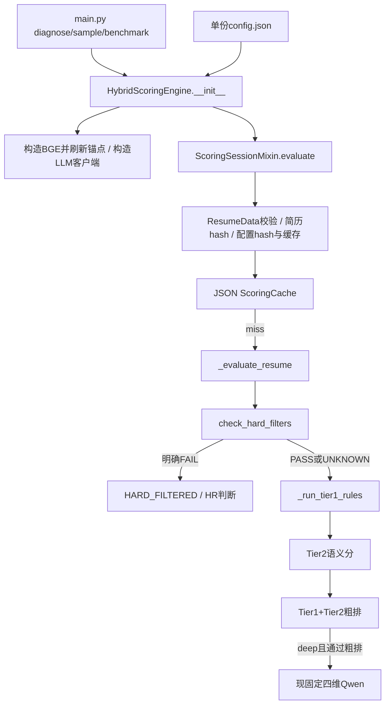

# Phase 1.7 Stage 4：实施前旧 Tier 0 / Tier 1 审计

审计日期：2026-11-14。本报告先于Stage 4算法实施形成；本次检查没有修改旧算法、旧Schema、配置或数据库历史。以下“当前事实”依据源码和明确标注的纯函数探针；“兼容方案”是拟实施设计，不能当作已完成或已通过验收。

## 1. 文件、实际入口和调用链

用户列出的 `scoring_engine.py` 在当前项目不存在；实际引擎为 `engine/hybrid_engine.py:25` 的 `HybridScoringEngine`。不是缺失文件需要重建或重命名。

关键定位：

| 文件/行号 | 已确认行为 |
| --- | --- |
| `engine/hybrid_engine.py:26` | 构造时读单份配置；未注入时加载SentenceTransformer，不能用该构造函数作为Stage4纯Tier0/1入口 |
| `engine/hybrid_engine.py:60`、`:64` | 读取/显式重载同一config_path；不是按job_candidate绑定版本加载 |
| `engine/hybrid_engine.py:110` | Tier0→Tier1→Tier2→Tier3调度；Tier1成功后立即运行Tier2 |
| `engine/scoring_session.py:53` | 校验ResumeData，内容hash排除meta，以当前引擎配置/model版本缓存 |
| `engine/resume_text.py:24` | 已分开职责、项目、毕设、工作标签、skills和advantage |
| `storage/repositories/candidates.py:42`、`:46`、`:52` | 带AccessContext读取岗位候选人、封存输入及该岗位采得的快照 |
| `storage/repositories/policies.py:159` | 按明确policy_id或policy_version读取授权范围内版本 |
| `storage/repositories/policies.py:153` | `get_current_policy`用于当前岗位配置查询，**不能**代替旧候选人的绑定版本 |

Stage4需独立入口直接执行Interpreter/Tier0/Tier1，不能仅给旧构造函数传fast_mode：旧fast_mode仍会构造BGE、运行Tier2。

## 2. 旧Tier 0全部过滤规则

实现：`engine/hard_filter.py`，入口 `check_hard_filters:94`。所有检查字典按“任意FAIL→整体FAIL；否则任意UNKNOWN→UNKNOWN；否则PASS”聚合，没有要求图ALL/ANY。

| 规则 | 当前事实 | 证据 |
| --- | --- | --- |
| 学历 | `min_degree`默认“不限”；不限直接PASS。degree与education[].degree统一取最高明确学历。明确低于要求FAIL，无可识别学历或配置未知UNKNOWN。没有把未知默认本科 | `degree_check:52` |
| 学历映射 | 中专1、高中2、大专3、本科4、硕士5、博士6；专科/大学本科/硕士研究生/博士研究生有别名。没有毕业状态证明；取最高学历不表示已经毕业 | `hard_filter.py:7` |
| 薪资格式 | 支持小数、K/千/万/元、区间、月/日/年及13薪等附加薪数；统一K保留原周期，区间混用单位UNKNOWN；面议、缺失、无法解析、非正数或倒置区间UNKNOWN | `parse_salary:20` |
| 薪资周期 | day/year有明确标记时识别，否则历史解析默认month；无单位仍UNKNOWN。额外薪数只记录，不换算成年包 | `parse_salary:20` |
| 薪资预算 | 未配上限PASS；未知或与salary_budget_period不同UNKNOWN；仅当候选薪资下限严格大于预算才FAIL，否则PASS（表示区间有预算内空间，不保证全部期望范围符合） | `check_hard_filters:98` |
| 求职状态 | 有job_status则精确命中exclude_job_status才FAIL，否则PASS；字段缺失且有排除配置则UNKNOWN；缺失且无排除配置不产生该检查 | `check_hard_filters:107` |
| 活跃状态 | 仅配置active_status_allowed时执行：缺失UNKNOWN、精确在列表PASS、明确不在列表FAIL | `check_hard_filters:111` |
| 工作年限 | 仅配置work_years_allowed时执行。字面在允许列表PASS；在校/应届按类型匹配处理。否则解析年数/区间，完全落允许区间PASS，部分重叠/配置不明UNKNOWN，明确不重叠FAIL | `years_check:66`、`check_hard_filters:113` |
| 历史职位 | 工作经历position命中exclude_position_keywords只追加PASS核验线索，不直接拒绝；这是当前已修复行为，不能再次改回一票否决 | `check_hard_filters:115` |
| 缺失/采集失败 | 整体ok=false或COLLECTION_FAILED在引擎调度前返回SCORING_FAILED；不是把数据错误当客观条件不符 | `hybrid_engine.py:119`附近 |

学历、薪资、年限的未知安全机制可以保留。活跃状态是旧采集平台特定信号，新Policy字段白名单未包含它，不能偷偷继承为新岗位硬门槛。历史职位词同样不能进入通用硬拒绝。

当前根config.json实际只配置本科、月薪12K、排除在职暂不考虑及历史岗位词；没有配置active_status_allowed或work_years_allowed。应区分“函数支持的规则”和“当前样例实际启用的规则”。

## 3. 旧Tier 1全部规则及公式

实现：`engine/rule_matcher.py:81`。

### 3.1 canonical、别名、去重及匹配

1. 从keyword_aggregation.aliases生成canonical映射，类别词表补充未注册canonical。
2. 合并high_value_tags与medium_value_tags；同一canonical仅保留基础score最高的一条，不叠加高/中两份配置。
3. 每个canonical检查自身及aliases；同一技术在多次/多个字段出现仍只有一个计分槽。
4. 英文数字和指定符号构成的词使用前后ASCII字母数字边界；其他词用casefold子串匹配。
5. 所有命中来源中只取最高来源权重。相同权重的并列项由tuple排序选择source/path，不汇总多份相同技术证据。

纯函数探针实际运行结果：

| `match_keyword('Java', text)` | 结果 |
| --- | --- |
| `Java` | True |
| `JavaScript` | False |
| `I have no Java experience` | True |
| `Learning Java only` | True |

因此Java/JavaScript边界是可保留机制，不能把它错误报告为旧版缺陷；否定/学习语境未处理是确实存在的新需求。中文子串和复杂版本符号仍有误命中/漏命中风险，不宣称当前正则具备自然语言理解。

### 3.2 来源及实战证据降权

`engine/resume_text.py:24`保留这些来源，企业/职位标题不混入职责：

| 来源 | 旧默认/当前配置权重 | 取值 |
| --- | --- | --- |
| work | 1.2 | responsibility、performance |
| project | 1.2 | description、achievement |
| thesis | 1.0 | thesis_description |
| work_tags | 0.35 | 工作经历keywords；或被标签启发式降级的职责/项目字段 |
| skills | 0.5 | skills |
| advantage | 0.4 | advantage |

`evidence_sources:37`会对work/project/thesis做标签检测：去前缀后按逗号/分号/顿号/换行等切分；各段短于32字符且是已知词或ASCII技术列表，并且没有实现动作时降为work_tags；“熟悉/精通/掌握”等能力前缀且无具体动作时也降级。实现动作词表大多偏开发：负责、实现、开发、设计、构建、部署、上线等。

这些是有限格式启发式，不证明经历真实性。销售“访谈/谈判/签约/回款”不在旧动作表，若照搬会造成岗位偏置。新机制应保留“标签不等于实战”的原则，而不是复制开发词表。

注意工作keywords和skills列表目前通过连接符拼成文本。新证据若要求连续原文定位，应针对原始字符串或原列表元素保留路径/片段，不把连接后的人工字符串当原始连续引用。

### 3.3 类别预算与饱和

对canonical `k`，基础分 `b_k`，命中来源集合 `M_k`：

`p_k = round(b_k × max(source_weight_s, s∈M_k), 4)`；未命中则0。

同一类别 `c`：`R_c = Σ p_k`。类别贡献：

`S_c = cap_c × (1 − exp(−R_c / scale_c))`。

旧Tier1分：`round(min(45, Σ S_c), 2)`；原始分单独保存为`round(Σ p_k, 2)`。类别cap总和必须≤45，cap非负，scale正值。

旧默认与当前类别：

| 类别 | cap | scale | 内容 |
| --- | --- | --- | --- |
| development_practice | 28 | 35 | Agent/RAG/自动化工具词表 |
| engineering | 12 | 18 | Python/FastAPI/BGE/Redis/Docker等 |
| efficiency | 5 | 8 | Cursor/Claude |

未显式分配类别的词默认engineering。每条规则可配置category，但缺省会落岗位专属默认。平滑饱和避免原始分134/93都简单截成45的旧问题；这个“有界单调饱和”机制有保留价值，具体三类别和数字不能直接套给销售/Java动态维度。

### 3.4 总分、四维与阈值

- 旧粗排分是Tier1≤45 + Tier2≤55，封顶100，`hybrid_engine.py:135`附近。
- 当前coarse_pass_score=52；fast_mode或粗排不足不调用Qwen，且没有正式深度分。
- Tier3成功后才给0–100正式total_score，当前AI四维权重40/30/20/10；不把粗排和深度分相加。
- review_threshold=60、auto_greet_threshold=82仅用于成功deep_mode路由，并另有完整性、明确硬条件、置信度、证据和开关门控。
- Stage4只执行Tier0/Tier1时，不能把旧Tier1的0–45直接与Policy的0–100 coarse_pass比较，不能声称新Tier1总分与旧粗排/深度分同口径。

## 4. 旧规则到通用Policy映射

| 旧字段/规则 | Policy目标 | 兼容注意 |
| --- | --- | --- |
| min_degree | hard_filters.education_level + GTE等 | 学历枚举/排序由受限适配器解释，不靠任意表达式 |
| max_expected_salary_k、salary_budget_period | expected_salary + LTE + value_number/unit | v1为CNY K，保留周期，不盲目折算；旧“区间下限有空间即PASS”必须明文决定是否沿用 |
| work_years_allowed | work_years + EQ/IN/GTE/LTE等 | 旧允许区间列表不能直接等价成单个阈值；区间重叠需UNKNOWN |
| exclude_job_status | job_status + NE或受限集合 | 不等式与缺失不能混为一谈；NE未知仍UNKNOWN |
| active_status_allowed | 无 | 不在Stage4白名单，不能隐式继承 |
| exclude_position_keywords | 无 | 仅旧核验提示，不应生成新硬拒绝 |
| high/medium tags、score | keyword_groups.keywords canonical/aliases/weight | 新weight范围(0,100]，不等价于旧3–18分基础分 |
| category/cap/scale | 动态维度+独立执行profile | Policy没有cap/scale；不能谎称它们已由HR配置 |
| 旧来源权重/标签识别 | 独立通用证据策略profile | Policy没有source weights和动作词表；开发专属动作必须替换 |
| 旧平面匹配 | requirements、requirement_groups图 | REQUIRED/PREFERRED/OPTIONAL、ALL/ANY都需解释，不是把所有叶子AND |
| 固定AI四维 | scoring_dimensions | 使用动态维度ID、label、weight、requirement_ids，不能复用旧四维输出类 |
| coarse_pass_score | thresholds.coarse_pass | 新Stage4初筛分口径必须显式定义 |
| review/auto阈值 | deep_review/deep_recommend | 本阶段只保留阈值供后续深评；不能用初筛分冒充深度推荐或自动发送 |

## 5. Stage 3协议/输入契约的已确认执行缺口

这些不是建议直接修改已发布JobScoringPolicy的理由。

### G1：关键词到要求是组级多对多

`schemas/job_policy.py:78`的KeywordGroup仅有整组requirement_ids，每个PolicyKeyword没有单独requirement_id。真实Java配置的“服务架构与设计”组同时列微服务架构/Spring Boot/Quarkus和req_java_dev/req_spring_boot/req_quarkus。任一关键词命中不能证明全部三条要求成立，也不能用同一命中给每个叶子满分。

兼容方案：Interpreter生成保守的派生执行关联，明确直接词对应/有歧义组级关联；不确定关联只作为辅助分和待核验，不作为硬满足/拒绝。以后如需精确per-keyword引用，另发新协议版本，不能覆盖已发布v1。

### G2：相对关键词weight不等于旧基础分

PolicyKeyword允许(0,100]；真实JavaSpring Boot=90、Quarkus=85、微服务=80。直接放旧scale18/35会迅速饱和。新公式需要归一化相对权重、保留最强证据/去重/有界机制并注明新口径；应测试关键词weight等比例缩放不改变相对覆盖。

### G3：执行系数没有写入Policy

Policy没有source weights、context因子、标签满分上限、priority奖金/折扣、类别scale、初筛cap。兼容方案：独立版本化执行profile，源自旧已测试来源权重并公开所有新增参数、理由与基准影响；维度权重仍只能来自Policy。输出记录profile版本/hash，不能偷偷从当前全局config.json取岗位规则。

### G4：部分必需能力没有客观hard谓词

硬条件只是原子要求的一部分；技能、职责、经验路线大多没有HardFilter。Tier0不能因缺关键词而FAIL，也不能因一个技术名出现而宣称硬能力已验证。尤其ANY(客观硬条件,不可直接执行能力)中，即使硬分支FAIL，能力分支还可能UNKNOWN，不能删除它后误拒。

兼容方案：分别记录客观谓词状态与证据能力状态，并明确图投影/UNKNOWN语义；允许图递归保留不可执行叶UNKNOWN，不以信息缺失作最终招聘淘汰。

### G5：根节点和priority依赖执行约定

Policy没有root_id。Stage3约定未被其他组引用的节点为根，多个REQUIRED根按ALL；ANY分支内REQUIRED只在该分支内生效。Interpreter应验证完整图后确定根，不遍历每个REQUIRED叶子再全局AND。PREFERRED/OPTIONAL不能透过父组或维度权重变成硬拒绝。

### G6：ResumeData缺工作授权/当前居住地

`schemas/candidate.py:8`只有expectation.city，含义是意向城市；ResumeData没有work_authorization或current_city。当前InputDataModel对额外字段会保留但记录UNKNOWN_FIELD，不代表字段已映射。

兼容方案：保持旧ResumeData不变，定义独立严格客观事实/字段适配视图，缺数据返回UNKNOWN；若使用expectation.city必须明确输出“意向城市”，不得说是当前居住地。没有明确授权信息不得推断。

直接给ResumeData补默认字段会改变`model_dump(exclude meta)`内容与旧resume_content_hash，可能使封存快照/JSON缓存/正式评分校验失配。这需要未来版本化mapper，不应作为本阶段便利修改。

### G7：旧输出不是动态初筛契约

旧EvaluationOutput带固定deep/fast状态、安全路由及deep分约束，LLMStructuredEvaluation固定AI四维。不能给Tier1初筛打DEEP_SCORED，不能让Tier1分覆盖Tier0 FAIL。应新增独立严格Preliminary结果契约，包含候选/岗位/绑定版本、动态维度、原子和图状态、可定位证据、待核验原因、明确初筛状态，保留旧类给旧路径。

## 6. 可以保留的机制与需替换的岗位逻辑

可保留：学历/薪资/年限UNKNOWN安全思路，明确客观事实判定，英文边界匹配，canonical/alias去重，单技术最强来源，职责/项目与标签分离，原文source_path，单调有界聚合，Pydantic重校验和受限字段白名单，Repository的组织/岗位授权及候选版本/输入封存。

新路径必须替换：固定Agent/RPA及Python工具词表、默认engineering、固定28/12/5类别、开发动作词偏置、平面所有条件ALL、单全局config读取、旧0–45分直接比较100分阈值、固定AI四维和AUTO路由入口。为兼容旧90项回归，应保留旧模块/旧CLI分支，不能把“新路径替换”误作删除旧实现。

## 7. 新旧兼容风险与验收建议

| 风险 | 必须验证的行为 |
| --- | --- |
| 错读岗位当前版本 | 通过job_candidate_id取绑定policy_id/version，V1/V2并存且旧候选未评分仍V1；严禁get_current_policy替代 |
| 规则缓存串岗 | 至少org_id/job_id/policy_id/policy_version参与隔离，复用同版本，检查相同键内容hash冲突 |
| 词多/长简历膨胀 | 同canonical/alias和重复字段不重复得分；明确否定、仅学习不得当实战 |
| AND/OR变形 | 递归三态真值表，ANY嵌套ALL、多个根、未可执行能力分支、优先级边界 |
| 新旧分数口径 | 同一固定候选集记录旧原始分/旧45分/新100分及原因；不要求数值相等，不把无模型基准称真实效果 |
| 语境启发式过度 | 否定/未实践/学习/项目提及分别保留原句和原因；不可靠判断UNKNOWN，不假证据 |
| 原文定位失真 | 每条quote能够从原始字段或原列表元素定位，路径和偏移不跨人工拼接文本 |
| 阈值越权 | Tier0 FAIL始终保留；UNKNOWN有待核验原因；初筛低分不等最终淘汰；deep阈值不授权AUTO |
| Schema/哈希变化 | 不修改已发布Policy、不加默认ResumeData字段、不迁旧JSON缓存、不复用旧深评分输出冒充初筛 |
| 运行时误加载模型 | 独立Stage4构造/执行不初始化Qwen/BGE，不调用旧evaluate整链；通过禁止网络/客户端spy验证 |

本报告只完成源代码审计和兼容方案说明，没有运行Stage4测试，也没有声称新公式、性能或三岗位初筛已实现。后续实现报告应引用本审计并填写实际验证结果。
